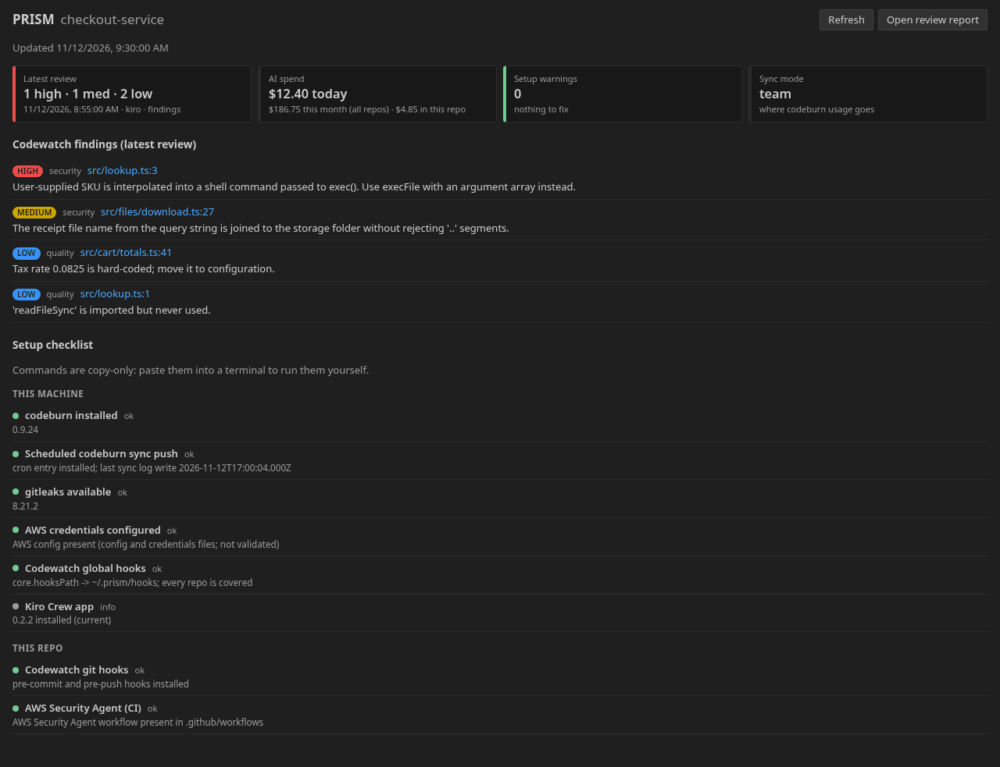
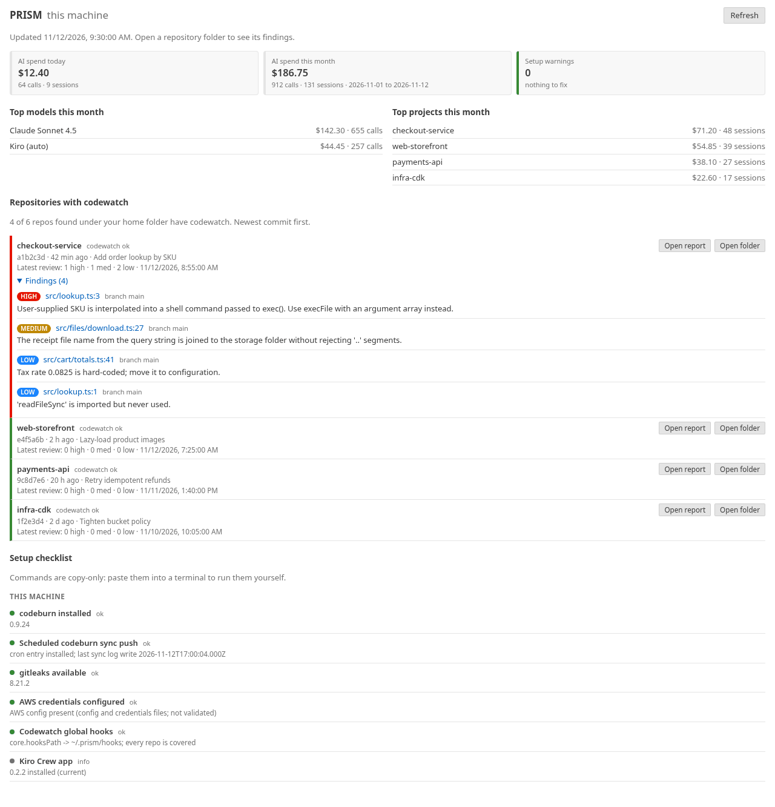
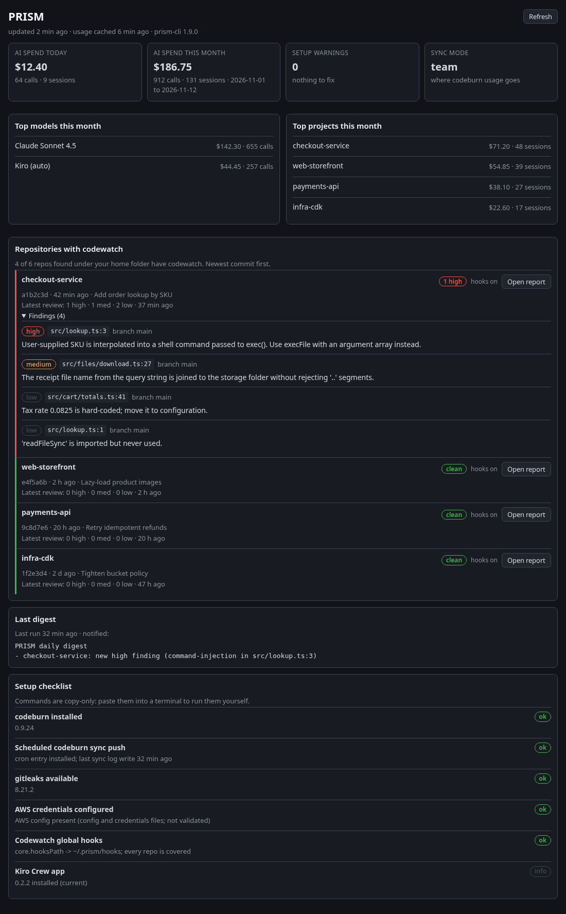
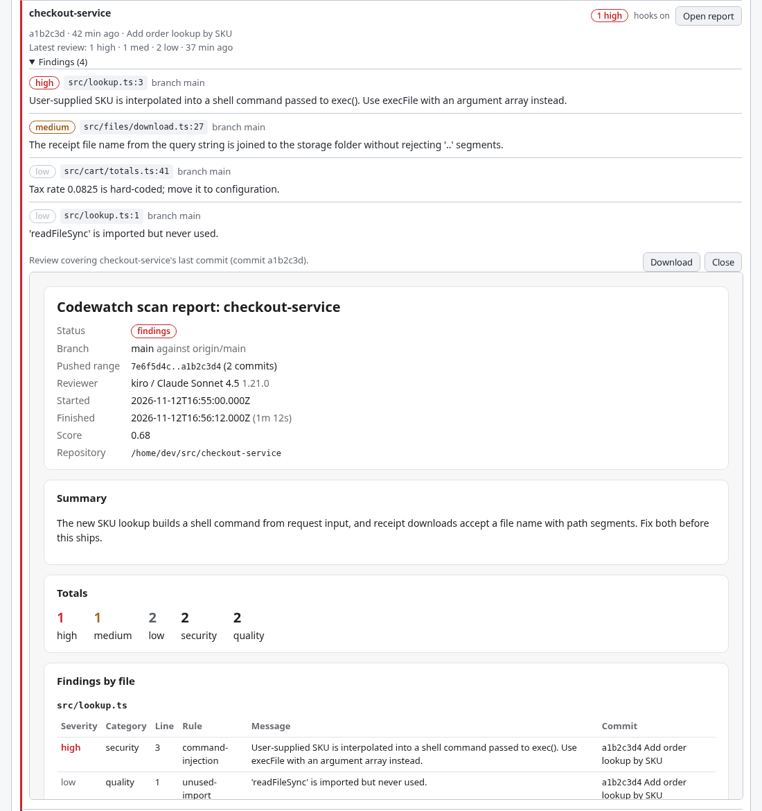

# PRISM D1 Velocity — User Guide

This guide is for engineering teams adopting AI-native software development practices with PRISM D1 Velocity. It covers infrastructure setup (administrators), developer onboarding, CI/CD workflows, eval gates, security scanning, dashboards, agent development, and the sample workshop application.

---

## Table of Contents

- [Prerequisites](#prerequisites)
- [Administrator Setup](#administrator-setup)
- [Developer Setup](#developer-setup)
- [Using PRISM locally](#using-prism-locally) (where PRISM shows up, commands by job, editor extension, MCP server, Kiro Crew app)
- [Codewatch (Local Git Hooks)](#codewatch-local-git-hooks)
- [Local Dashboard](#local-dashboard)
- [Security Agent Setup (enable security)](#security-agent-setup-enable-security)
- [Security Scans from Your Machine](#security-scans-from-your-machine)
- [CI-CD Workflows (GitHub and GitLab)](#ci-cd-workflows-github-and-gitlab)
- [Eval Gates](#eval-gates)
- [AWS Account Advice (aws connect, check, recommend)](#aws-account-advice-aws-connect-check-recommend)
- [Bedrock Protection Audit](#bedrock-protection-audit)
- [Dashboards](#dashboards)
- [Agent Development (MCP + Agent Configs)](#agent-development-mcp--agent-configs)
- [Sample App](#sample-app)
- [Troubleshooting](#troubleshooting)
- [Event Schema](#event-schema)

Every prism-cli command and flag is in the [command reference](docs/CLI-REFERENCE.md), generated
from `--help`. This guide explains what each feature does and how to set it up.

---

## Prerequisites

- **AWS CLI v2** (latest) — For EventBridge event emission and Security Agent. Install from [official installer](https://docs.aws.amazon.com/cli/latest/userguide/getting-started-install.html) — do NOT use package managers.
- **Node.js 22+** — Required for prism-cli and the sample app
- **jq** — For JSON processing in CI/CD workflows and eval harness
- **prism-cli** — Install: `npm install -g @prism-d1/cli`
- **codeburn** — **Required.** `codeburn sync push` is the only writer to the attribution store, so every AI metric depends on it: AI share, AI-to-merge ratio, AI defect rate, cost per shipped commit, Attribution Coverage, the observed PRISM level, and the entire Developer Productivity dashboard. Install and connect it with `prism-cli enable codeburn`, which runs `npm install -g codeburn` when it is missing (or install it yourself, e.g. `brew install codeburn` on macOS), authenticates and installs the sync schedule. codeburn is what parses Kiro, Claude Code, Cursor and other tool sessions — prism-cli does not parse them itself.
- **GitHub Actions or GitLab CI** — For CI/CD workflows
- **AWS OIDC** — For secure CI/CD to AWS authentication (set up via `setup-github-oidc` or `setup-gitlab-oidc`)
- **Amazon Bedrock** — Model access must be enabled for code evaluation
- **Python 3.11+** — For the agent (sample-app/agent)
- **AWS account with Bedrock AgentCore access** — For agent deployment

---

## Administrator Setup

### Step 1: Deploy PRISM Infrastructure

Deploy the CDK stacks — EventBridge bus, DynamoDB tables, Lambda processors, the OTEL collector, four CloudWatch dashboards, alarms, and Bedrock Guardrails:

```bash
cd infra
npm install
npx cdk deploy --all --context enableSecurityAgent=true
```

`enableSecurityAgent=true` additionally creates the AWS Continuum scan bucket and the `prism-d1-continuum-ci-scan` managed policy that Step 2 attaches to the OIDC role. Leave the flag off for a metrics-only deployment. On a non-production deployment, add `--context skipVpc=true` to save roughly $35–50/month.

Note the **`OtelCollectorUrl`** and **`OtelUserPoolId`** outputs — you need both in Step 5, and developers need the URL for `prism-cli enable codeburn`.

**Or let prism-cli set up Security Agent.** `prism-cli enable security` deploys only the Security
Agent resources (after showing a diff and asking) and then does the Continuum onboarding for the
repo you run it in. If you use it, deploy the pipeline above **without**
`--context enableSecurityAgent=true`. See [Security Agent Setup](#security-agent-setup-enable-security).

### Step 2: Set Up OIDC (CI/CD → AWS Authentication)

**GitHub:**
```bash
prism-cli bootstrapper setup-github-oidc
```

This interactively creates:
- OIDC identity provider for `token.actions.githubusercontent.com`
- IAM role `GitHubActions-<repo>` with trust policy scoped to your repo
- Inline policy with `events:PutEvents` and `bedrock:InvokeModel` (the latter is granted
  unconditionally, but only `prism-agent-eval.yml` consumes it — the eval gate does not)

Add `PRISM_METRICS_ROLE_ARN` as a GitHub repo secret (ARN printed by the command).

**GitLab:**
```bash
prism-cli bootstrapper setup-gitlab-oidc
```

Creates OIDC provider + IAM role. Add `PRISM_METRICS_ROLE_ARN` as a CI/CD variable (unprotected).

**One role for many repos.** By default the role trusts one repository (GitHub) or project
(GitLab). `--global` creates one role (`GitHubActions-<owner>-all` or `GitLabCI-<group>-all`) whose
trust policy accepts every repo of the GitHub owner (or every project of the GitLab group), which is
simpler to roll out but lets any of those repos assume it. `setup-github-oidc --pin-ids` pins the trust policy to GitHub's
immutable owner and repo ids instead of names, so a deleted and re-created name cannot inherit the
role (private repos may need the `gh` CLI or `GITHUB_TOKEN`). `setup-gitlab-oidc --project-id`
does the same with the numeric project id.

Both commands take `--region <region>` (default `us-west-2`), which sets the event bus ARN in the
inline policy. Pass the same region to the workflow installer below, or `events:PutEvents` will be
denied at merge time. See [IAM Permissions Required](#iam-permissions-required).

### Step 3: Install CI/CD Workflows and Eval Harness

Run these from the root of the repository you want instrumented. They only write files — nothing
reaches AWS until you commit them and a PR merges.

**CI/CD workflows.**

```bash
# GitHub — writes three workflows to .github/workflows/
prism-cli bootstrapper install-github-workflows --region us-west-2

# GitLab — writes to .prism/gitlab-workflows/
prism-cli bootstrapper install-gitlab-workflows --gitlab-url https://gitlab.com --region us-west-2
```

Both platforms get the same eval gate: agentic review via kiro-cli headless plus gitleaks secret
scanning, installed as `prism-eval-gate.yml`. Both require a `KIRO_API_KEY` secret (GitHub) or
masked CI/CD variable (GitLab).

For GitLab, merge `.prism/gitlab-workflows/.gitlab-ci.yml` into your repo root `.gitlab-ci.yml`
afterwards; the installer deliberately does not overwrite an existing pipeline definition.

Pass the **same `--region` you gave `setup-github-oidc` in Step 2**. The OIDC policy scopes
`events:PutEvents` to one region's event bus, and the installer rewrites every region reference in
the workflows it copies — a mismatch is denied at merge time with nothing failing at setup.

> **`--mode bedrock` is retired.** Passing `--mode bedrock` now exits 1 with a migration message.
> The Bedrock eval gate asset has been removed from the GitHub workflow set.

**Eval harness.**

```bash
prism-cli bootstrapper install-eval-harness
```

This installs four things into your repo:

1. `.kiro/steering/code-review.md` — review rules (plain English) used by the kiro-cli eval gate
2. `.github/workflows/prism-eval-gate.yml` — the kiro-cli headless CI workflow
3. `.gitleaks.toml` — starter allowlist for secret scanning
4. `.prism/eval-harness/` — containing `run-eval.sh`, `eval-config.json`, and `rubrics/agent-quality.json`

> **Important:** `.prism/eval-harness/` is now used **only** by `prism-agent-eval.yml` (which scores
> agent output via Bedrock). It is **not** used by the eval gate. The eval gate reads
> `.kiro/steering/code-review.md` for its review rules and runs gitleaks for secret scanning.

The kiro-cli gate needs `KIRO_API_KEY` from the next step and a paid Kiro subscription.
See [Eval Gates](#eval-gates) for full details.

Its flags (region, the agent-eval model and threshold, skipping `.prism/eval-harness/`,
`--uninstall`) are in the
[command reference](docs/CLI-REFERENCE.md#prism-cli-bootstrapper-install-eval-harness).

> **`--mode` and `--with-rubrics` are retired.** Passing `--mode bedrock` now exits 1 with a
> migration message.

**Team attribution (optional).** `prism-ai-metrics.yml` reads the team id from `.prism/config.json`
in the repo. Create it by hand — it is a single field, and the git-hook installer that used to
generate it is deprecated:

```json
{ "team_id": "team-alpha" }
```

Without the file, events are emitted under `no_team` rather than failing the run.

Committing the workflows before the next step is safe: without `PRISM_METRICS_ROLE_ARN` the AWS
credential step fails and the job stops before emitting anything.

### Step 4: Configure GitHub Secrets

In GitHub → your repo → Settings → Secrets and Variables → Actions, add two secrets:

| Name | Value | Where to Find It | Used By |
|---|---|---|---|
| `PRISM_METRICS_ROLE_ARN` | ARN printed by `setup-github-oidc` | Step 2 output | All three installed workflows |
| `KIRO_API_KEY` | Kiro API key | https://app.kiro.dev → Settings → API Keys | `prism-eval-gate.yml` |

No repository **variables** are required — the workflows read none. Team identity comes from a file in the repo instead, `.prism/config.json`:

```json
{ "team_id": "team-alpha" }
```

`prism-ai-metrics.yml` reads that file with `jq` and falls back to `no_team` when it is absent, so a missing config downgrades attribution grouping rather than failing the run and losing that PR's facts.

`KIRO_API_KEY` requires a paid Kiro subscription.

### Step 5: Create Developer Accounts

After deploying, create a Cognito user for each developer so they can authenticate with the OTEL collector. `prism-cli team` does this for the platform team:

```bash
prism-cli team info                                  # read-only: OtelCollectorUrl, OtelUserPoolId, and the line to send developers
prism-cli team add-developer dev@example.com --dry-run   # the plan: account, region, user pool, email
prism-cli team add-developer dev@example.com             # asks, then creates the user (--yes for scripts)
```

- **`team info`** is read-only. It finds the `PrismD1MetricsPipeline` stack with the same AWS profile and region resolution as `aws check` (`--profile`, `--region`, then `prism-cli aws connect`), and prints its `OtelCollectorUrl` and `OtelUserPoolId` outputs plus a copy-paste line for developers: `prism-cli enable codeburn --url <url>`. `--json` prints the same as JSON. Needs `cloudformation:DescribeStacks`.
- **`team add-developer <email>`** is an AWS write: one Cognito `AdminCreateUser` on the stack's `OtelUserPoolId` (or `--user-pool-id`), with the email as the username. It prints the account, region, pool and email, and asks before creating; `--dry-run` changes nothing. A user that already exists is reported as "already exists, nothing changed". Cognito emails the invite with a temporary password; prism-cli never sees, prints or stores it. Needs `cloudformation:DescribeStacks` (unless `--user-pool-id`) and `cognito-idp:AdminCreateUser`.

The same with the AWS CLI:

```bash
# Create a user (username MUST be the developer's email)
aws cognito-idp admin-create-user --user-pool-id <OtelUserPoolId output> --username dev@example.com
```

Then share the **OtelCollectorUrl** stack output with your developers — they'll need it for setup below. `prism-cli enable codeburn --admin` prints these platform-team steps on any machine without calling AWS.

**Bring your own IdP** (Okta, Entra ID) instead of Cognito:

```bash
npx cdk deploy --all \
  -c otelIssuer=https://login.example.okta.com/oauth2/default \
  -c otelClientId=0oa1b2c3d4 \
  -c otelIdentityClaim=email
```

Your IdP app must be a **public client with PKCE**, register loopback redirect URIs `http://127.0.0.1:19876/callback` (also ports 19877, 19878), and issue **JWT access tokens** (Okta and Entra ID work; Auth0's opaque access tokens are not supported).

**Federate your IdP *inside* Cognito** instead of replacing it. Developers sign in with corporate credentials, but Cognito stays in the path:

```bash
npx cdk deploy --all \
  -c otelIdpName=CorpIdP \
  -c otelIdpIssuer=https://idp.example.com \
  -c otelIdpClientId=your-client-id \
  -c otelIdpClientSecretArn=my-idp-client-secret \
  -c otelIdentityClaim=email
```

Which option to pick:

| | Bring your own IdP (`otelIssuer`) | Federated IdP (`otelIdpName`) |
|---|---|---|
| Cognito user pool | not created | created, IdP added to it |
| Corporate sign-in | yes | yes |
| Machine-to-machine agent client | **not available** | available |

That last row is the deciding factor for most teams. The OAuth resource server and the client-credentials client that the [coding agent](coding-agent/README.md) uses to push its own telemetry are only created on the Cognito path, so `otelIssuer` silently removes the agent's route to the collector. Choose the federated option if you run the coding agent.

Additional flags: `otelIdpClientSecretJsonKey` if the secret holds JSON rather than a plain string, and `otelIdpScopes` (default `openid email`). The first four flags above must be supplied together — the construct throws on a partial set.

**Before deploying**, put the IdP client secret in Secrets Manager. The value never belongs in a context flag or a template:

```bash
aws secretsmanager create-secret --name my-idp-client-secret --secret-string '<client-secret>'
```

**At your IdP**, register Cognito's callback URL:

```
https://prism-d1-otel-<account-id>.auth.<region>.amazoncognito.com/oauth2/idpresponse
```

#### Why `otelIdentityClaim=email` is required here

Commit attribution keys developers on their **git author email**, so identity resolution has to produce an email or each developer appears twice — once holding their AI token spend, once holding their commits.

Cognito ID tokens carry `email`, but **access tokens do not**, and the HTTP API authorizer validates the access token. Without help, the receiver falls back to `username`, which Cognito prefixes with your provider name (`corpidp_alice`). The deploy therefore also creates a **pre-token-generation trigger** that copies `email` into the access token.

The trigger and the flag are co-dependent, and neither works alone:

| Trigger | `otelIdentityClaim=email` | Resolved identity |
|---|---|---|
| yes | no | `corpidp_alice` — trigger is a silent no-op |
| no | yes | `corpidp_alice` — claim absent, falls through to username |
| yes | yes | `alice@example.com` |

`cdk synth` emits a warning if you configure an IdP without the flag. Access token customization requires the Cognito **Essentials or Plus** feature plan; it is unavailable on Lite.

#### Backfilling emails for existing users

The IdP attribute mapping populates `email` on **sign-in**, so anyone who signed in before you added the mapping has `email: null` and keeps resolving to the prefixed username. The trigger fails open by design — those users keep working rather than being locked out of sync — so the fleet converges as people sign in again.

To avoid waiting, set the attribute directly. The next hourly token refresh picks it up with no re-login:

```bash
aws cognito-idp admin-update-user-attributes \
  --user-pool-id <OtelUserPoolId output> --username CorpIdP_alice \
  --user-attributes Name=email,Value=alice@example.com
```

Be aware the mapping **overwrites** `email` on each federated sign-in. If your IdP returns a different address than the one you set, that developer's identity moves again at their next sign-in.

#### Migrating telemetry already stored under the old identity

Switching identities does not move existing data: history stays under `USER#<provider>_<alias>` in `prism-d1-ai-usage` while new spans land under `USER#<email>`, and dashboards show both rows until you reconcile them. `OTEL_SPAN` records expire on their 90-day TTL, but `OTEL_DAY` aggregates persist indefinitely.

If you re-push history instead of copying it, note two things. `codeburn sync push` skips anything already sent, so a genuine re-push needs `codeburn sync reset --confirm` first, and it can only send telemetry still on the developer's disk — older days may no longer exist locally. `OTEL_DAY` counters are also written with DynamoDB `ADD`, so re-pushing into a partition that **already** holds data double-counts it; only re-push into an empty identity.

### IAM Permissions Required

You do not need to write these policies — Step 2 attaches both. This is a reference for
review, or for building the role by hand.

**Inline policy `PrismD1WorkshopPolicy`**, created by `setup-github-oidc` / `setup-gitlab-oidc`:

| Permission | Resource | Used by |
|---|---|---|
| `events:PutEvents` | `event-bus/prism-d1-metrics` | All workflows |
| `bedrock:InvokeModel` | `*` | `prism-agent-eval.yml`, via `.prism/eval-harness/run-eval.sh` |

`bedrock:InvokeModel` is **not** needed for the eval gate — `prism-eval-gate.yml` calls the Kiro
API with `KIRO_API_KEY` and never touches Bedrock. It is only required if you use
`prism-agent-eval.yml` for agent output scoring.

The eval gate installs to `.github/workflows/prism-eval-gate.yml` and needs only `events:PutEvents`
and `KIRO_API_KEY`.

**Managed policy `prism-d1-continuum-ci-scan`**, created by the CDK when you deploy with
`--context enableSecurityAgent=true`, and attached to the same role by Step 2. Required by the
Continuum security-finding gate in both eval-gate workflows:

| Sid | Actions | Resource |
|---|---|---|
| `ContinuumScanAPIs` | `securityagent:CreateCodeReview`, `ListCodeReviews`, `StartCodeReviewJob`, `BatchGetCodeReviewJobs`, `BatchGetCodeReviewJobTasks`, `ListFindings`, `BatchGetFindings` | `agent-space/*` |
| `PassRoleForCodeReview` | `iam:PassRole` (conditioned on `iam:PassedToService = securityagent.amazonaws.com`) | The Continuum service role |
| `ScanBucketWrite` | `s3:PutObject`, `s3:GetObject`, `s3:ListBucket` | The Continuum scan bucket |
| `KMSForScanBucket` | `kms:Encrypt`, `kms:Decrypt`, `kms:GenerateDataKey*`, `kms:DescribeKey` | The PRISM KMS key |
| `SSMReadConfig` | `ssm:GetParameter`, `ssm:GetParameters`, `ssm:PutParameter` | `parameter/prism/continuum/*` |

`PutParameter` is needed because the eval gate writes the Code Review id it creates back to
`/prism/continuum/code-review-id/<repo-slug>`. KMS appears because the scan bucket is
encrypted with a customer-managed key — bucket access alone is not enough.

If this policy is absent, `setup-github-oidc` says so and the eval gate skips security scanning
rather than failing.

> **Keep the region consistent.** The inline policy scopes `events:PutEvents` to one region's
> event bus, so the OIDC setup and the workflow installer must be given the same region or
> `put-events` fails with AccessDenied at merge time — nothing errors at setup:
>
> ```bash
> prism-cli bootstrapper setup-github-oidc      --region eu-west-1
> prism-cli bootstrapper install-github-workflows --region eu-west-1
> ```
>
> Both default to `us-west-2`, so you can omit the flag entirely if that is where you deployed.
> GovCloud and China regions are rejected — every ARN the bootstrapper builds is hard-coded to
> the `aws` commercial partition.

---

## Infrastructure Configuration

### VPC Configuration

By default, all Lambda functions deploy into a VPC with private isolated subnets and VPC endpoints (gateway: S3, DynamoDB — free; interface: EventBridge, CloudWatch, CloudWatch Logs, KMS, Bedrock Runtime — billable) for network isolation. This adds ~$35-50/month in endpoint costs.

| Option | Command | Use Case |
|--------|---------|----------|
| **New VPC** (default) | `npx cdk deploy --all` | Production — full network isolation |
| **Skip VPC** | `npx cdk deploy --all -c skipVpc=true` | Workshop/demo — saves cost, faster cold starts |
| **Existing VPC** | `npx cdk deploy --all -c vpcId=vpc-0123456789abcdef0` | Enterprise — use shared VPC with existing endpoints or NAT |

When using an existing VPC, ensure it has either VPC endpoints for the required services or a NAT gateway for outbound internet access.

**Data layout:**

| Destination | Content | Purpose |
|-------------|---------|---------|
| S3 (`prism-d1-otlp-archive-*`) | Raw OTLP JSON batches, partitioned by `dt=` | External contract — Athena, data lake, replay into any OTel backend |
| DynamoDB (`prism-d1-ai-usage`) | Per-span rows (90-day TTL) + daily per-user/tool aggregates | PRISM dashboards |

Duplicate pushes are safe: codeburn's deterministic span IDs act as an idempotency key server-side. Historical sessions are backfilled on first push (aggregates bucket by span date). Running a full ADOT collector for fan-out to X-Ray/Grafana/Datadog is on the [roadmap](docs/ROADMAP.md).

### Cost Estimate

Monthly cost depends on team size and configuration. All resources are serverless (pay-per-use) except VPC endpoints.

| Component | ~Monthly Cost | Notes |
|-----------|--------------|-------|
| **VPC endpoints** (5 interface) | $35–50 | Gateway endpoints (S3, DynamoDB) are free. Skip all with `-c skipVpc=true` |
| **DynamoDB** (3 tables) | $1–5 | On-demand billing; scales with commit volume |
| **Lambda** (11 functions) | $1–3 | Invoked per event; negligible at <50 devs |
| **EventBridge** | < $1 | $1/million events |
| **CloudWatch** (4 dashboards, 9 alarms) | $3–10 | Per-dashboard fee + metric costs |
| **OTEL Collector** (API Gateway + Cognito + S3) | $2–5 | Per-request + S3 storage |
| **Bedrock Guardrails** | $1–5 | Per-invocation; depends on eval gate frequency |
| **KMS** (1 key) | $1 | Fixed monthly fee + $0.03/10K requests |

**Typical total:**
- Workshop/demo (no VPC): **~$10–25/month**
- Production (with VPC, <50 devs): **~$50–80/month**
- Large team (100+ devs, heavy CI): **~$80–150/month**

> 💡 The largest cost driver is VPC endpoints. For workshops and demos, use `-c skipVpc=true` to stay under $25/month.

## Developer Setup

One command per machine. There is nothing else a developer must install for telemetry — no git
hooks, no per-repo configuration, no CI changes. The optional local checks are covered separately in
[Codewatch (Local Git Hooks)](#codewatch-local-git-hooks).

```bash
npm install -g @prism-d1/cli
prism-cli enable codeburn --url <OtelCollectorUrl>
```

`<OtelCollectorUrl>` is the CDK stack output from Step 1; get it from your platform team. Your platform
team creates your telemetry account in Step 5, using your email address as the username.

**Sync modes.** `enable codeburn` saves where your usage goes, once per user, in `~/.prism/codeburn.json`.
Without a flag it asks "Where should your usage go?" on a terminal:

1. **local** (the default): just me, keep it on this machine. codeburn still works locally (the
   dashboard's usage panel, `codeburn web`); no sync endpoint is set up and no schedule is installed.
   With no terminal and no flag, this is the mode.
2. **team**: my team's PRISM, with the collector URL from the platform team. The steps below.
3. **admin**: I'm the platform team setting up PRISM. It prints the platform-team steps and the
   `prism-cli team` commands, and makes no AWS calls.

`--local`, `--url <url>` (team) and `--admin` choose the mode without the question, and a re-run
with a different flag changes it. A machine that already syncs (an endpoint is configured but no
mode is saved) is treated as team. Moving to local leaves an existing endpoint and schedule in place
and says so, because the schedule still pushes; `--local --remove` also removes the schedule.
`--status` shows the mode.

In team mode the command takes these steps, and a re-run reports the ones already done:

1. **Installs codeburn** when it is not on PATH. It prints the exact command
   (`npm install -g codeburn`) and asks first; `--yes` skips the question. With no terminal and no
   `--yes` it stops and prints the command for you to run.
2. **Connects codeburn's sync** with `codeburn sync setup <url>`, which opens a browser to sign in to
   the Cognito user pool. Skipped when codeburn already syncs to that URL. Without `--url`, it uses
   the URL codeburn is already configured with, and otherwise asks for one.
3. **Backfills** 30 days of history (`codeburn sync push --since 30d --attribution`), on first setup
   only.
4. **Installs a platform-native schedule** — crontab on Linux, LaunchAgent on macOS, Scheduled Task
   on Windows — that runs `codeburn sync push --since 7d --attribution` every 12 hours
   (`--interval <hours>` changes it), pushing AI usage **and** per-commit attribution. An existing
   schedule is refreshed in place. On Linux, `--schedule systemd` uses a systemd user timer instead
   of your crontab, and when the crontab cannot be read a systemd user timer is offered (`--yes`
   accepts it).
5. **Reports `codeburn sync status`.**

`--dry-run` prints the plan with the exact commands and changes nothing. `--status` shows codeburn,
the sync config, the schedule, the last sync log lines and `codeburn sync status`. `--remove`
removes the schedule (on Linux both kinds, unless `--schedule` picks one). Every flag:
[`prism-cli enable codeburn`](docs/CLI-REFERENCE.md#prism-cli-enable-codeburn).

**Push now.** `prism-cli export otel` runs the same push the schedule runs
(`codeburn sync push --since 7d --attribution`), streams codeburn's output and exits with codeburn's
exit code. `--since <window>` changes the window (`today`, `7d`, `30d`, `month`, `all`). It stops
with a pointer to `prism-cli enable codeburn` when codeburn is missing or its sync is not set up.

**Check your install.** `prism-cli version` prints the CLI and Node versions, says whether npm has
a newer `@prism-d1/cli` (a 5-second `npm view` that never fails the command; `--offline` skips it),
and warns when another `prism-cli` on PATH shadows this one or has a different version, such as an
old `/usr/bin/prism-cli` from a system Node. `--json` prints the same report. `prism-cli --version`
still prints only the version number.

**This is required, not optional.** `codeburn sync push` is the only writer to the attribution store,
so every AI metric depends on it: AI share, AI-to-merge ratio, AI defect rate, cost per shipped
commit, Attribution Coverage, the observed PRISM level, and the entire Developer Productivity
dashboard. codeburn is also what parses Kiro, Claude Code, Cursor and other tool sessions —
`prism-cli` does not parse them itself.

**Attribution Coverage is the number to watch first.** The dashboards compare commits CI observed
(a complete census of the repo) against commits attribution captured (only onboarded machines).
Below 80%, every AI metric understates reality, and the fix is getting more developers through this
one command — not changing the dashboard.

Verify with `prism-cli enable codeburn --status`. Within one sync cycle the
**PRISM-D1-Team-Velocity** dashboard should show AI-vs-human commit counts and a coverage
percentage.

> The commit-trailer hook (`prepare-commit-msg`) and its token tracker are retired and are not part
> of developer setup. AI origin now comes from codeburn attribution, which is why these metrics
> survive the hook's removal. If you are migrating off it, see
> [Commit Trailers and Token Tracker (retired)](#commit-trailers-and-token-tracker-retired) in
> Troubleshooting.

---

## Using PRISM locally

`prism-cli` is the local command line for PRISM, published on npm as
[`@prism-d1/cli`](https://www.npmjs.com/package/@prism-d1/cli). It needs Node.js 22 or later.

```bash
npm install -g @prism-d1/cli
prism-cli version        # installed version, newer release on npm, other copies on PATH
```

### Where PRISM shows up

The local results (codewatch reviews, AI spend, the setup checklist) appear in these tools. All of
them read the same local data as `prism-cli dashboard` and make no AWS calls.

| Feature | VS Code family (VS Code, Kiro IDE, Cursor) | Kiro Crew | Claude Code plugin (v0.1, WIP) |
|---|---|---|---|
| Codewatch findings | Yes: Problems markers, status bar counts, PRISM panel | Yes: PRISM sidebar page | Yes: `/prism:findings`, and a summary of the branch's open findings at session start |
| Open a review report | Yes: quick fix and panel button | Yes: on the page (sandboxed) | Yes: `/prism:report` |
| AI spend | Yes: status bar (today), panel (today, month, top models) | Yes: on the page | Yes: `/prism:spend`; a status line is planned |
| Setup checklist | Yes: panel, with fix commands to copy | Yes: on the page | Yes: `/prism` lists failing items with fix commands |
| MCP tools (`prism-cli mcp`) | No, not from the extension (Kiro IDE can add the MCP server in its own settings) | Yes: the `prism` MCP server, plus the `prism-fix-findings` skill | Yes: the plugin's `prism` MCP server |
| Notifications / digest | No | Yes: a daily digest, only when something changed | Planned |
| Plugin, slash commands | No | No | Yes: `/prism`, `/prism:findings`, `/prism:report`, `/prism:fix`, `/prism:spend` |
| Where it runs | With a repo open or without one (machine mode), and on the remote host over Remote-SSH | The Kiro Crew gateway's machine | Wherever `claude` runs |
| Install | `code --install-extension prism-d1-<version>.vsix` (`kiro` or `cursor` instead of `code`), from the [`ext-v*` releases](https://github.com/aws-samples/sample-prism-d1-velocity/releases?q=ext-v&expanded=true) | `prism-cli enable kirocrew` | `/plugin marketplace add aws-samples/sample-prism-d1-velocity`, then `/plugin install prism@prism-d1-velocity` |

Claude Code support is a work in progress. The [Claude Code plugin](#claude-code-plugin) (v0.1)
bundles the [MCP server](#mcp-server-prism-cli-mcp), slash commands and a SessionStart hook. A
status line and a review loop that runs before Claude finishes are planned.

### Commands by job

Most features run on a developer machine with no AWS deployment: the
[codewatch git hooks](#codewatch-local-git-hooks), the [local dashboard](#local-dashboard), the
[editor extension](#editor-extension), the [MCP server](#mcp-server-prism-cli-mcp), the
[Kiro Crew app](#kiro-crew-app), the [Claude Code plugin](#claude-code-plugin) and the read-only
[AWS account checks](#aws-account-advice-aws-connect-check-recommend).

| Job | Commands | How-to |
|-----|----------|--------|
| Send AI usage to PRISM | `enable codeburn`, `export otel` | [Developer Setup](#developer-setup) |
| Check changes before they leave your machine | `enable codewatch`, `codewatch report` | [Codewatch](#codewatch-local-git-hooks) |
| See results locally | `dashboard`, `mcp`, `enable kirocrew`, the editor extension | [Local Dashboard](#local-dashboard), [Where PRISM shows up](#where-prism-shows-up) |
| Security scans | `enable security`, `security code-review`, `security findings`, `security threat-model`, `security threats`, `security pentest` | [Security Agent Setup](#security-agent-setup-enable-security), [Security Scans from Your Machine](#security-scans-from-your-machine) |
| Check an AWS account | `aws connect`, `aws check`, `aws recommend`, `bedrock-protection scan-account`, `scan-org`, `scan-repo` | [AWS Account Advice](#aws-account-advice-aws-connect-check-recommend), [Bedrock Protection Audit](#bedrock-protection-audit) |
| Platform team | `team info`, `team add-developer`, `bootstrapper setup-github-oidc` and the other `bootstrapper` commands | [Administrator Setup](#administrator-setup) |
| Assess a team | `assessment run`, `assessment web`, `assessment deploy-cdk` | [Assessment Guide](assessment/ASSESSMENT_GUIDE.md) |
| Run the workshop | `workshop verify-setup`, `deploy-infra`, `generate-demo-data`, `run-agent`, `perform-pen-test` | The workshop modules |

Every command and flag, generated from `--help`, is in the
**[command reference](docs/CLI-REFERENCE.md)**, including the deprecated old names. The
[prism-cli Overview](docs/PRISM-CLI-OVERVIEW.md) lists what each command touches in AWS and what it
costs.

### Editor extension

The [editor extension](editor-extension/README.md) works in VS Code, Kiro and Cursor. It puts this
repo's codewatch findings in the Problems panel and a one-line summary (findings, spend today,
setup warnings) in the status bar, with a side panel for the setup checklist. With no repository
open it shows the whole machine instead. It reads `prism-cli dashboard --json`, opens no ports and
makes no AWS calls. It needs prism-cli 1.7.1 or later.

Download `prism-d1-<version>.vsix` (0.1.1 at the time of writing) and its `.sha256` from the
latest [`ext-v*` release](https://github.com/aws-samples/sample-prism-d1-velocity/releases?q=ext-v&expanded=true),
then install it with `code --install-extension prism-d1-<version>.vsix` (or `kiro`, `cursor`).
Checking the download, Remote-SSH, features, settings and security:
[editor extension README](editor-extension/README.md#install).





*The PRISM panel with a repo open (top) and with no repo open (bottom). Both show made-up demo data.*

### MCP server (prism-cli mcp)

`prism-cli mcp` is an [MCP](https://modelcontextprotocol.io) server that gives an AI agent (Kiro,
Claude Code or any MCP client) the same local data as the dashboard. The client starts it and talks
to it over stdin and stdout; it opens no port, starts no background process and exits when the
client closes stdin. It makes no AWS or network calls and never runs a fix. It needs prism-cli 1.8.0
or later.

| Tool | Arguments | Returns |
|------|-----------|---------|
| `prism_status` | none | Spend today and this month, setup warning count and the first warning, the latest codewatch review (repo, when, counts), repos with codewatch, sync mode, prism-cli version |
| `prism_findings` | `repo`, `branch`, `limit` (at most 50) | Findings of the latest pre-push review: severity, category, file, line, message, branch, commit, reviewer, time. Default repo: the one containing the client's working directory |
| `prism_spend` | `days` (at most 31) | Today, this month, calls, sessions, top models, top projects (folder names), per-day rows, `updatedAt` and `stale` |
| `prism_report` | `repo`, `commit` (default `HEAD`), `format` (`md` or `html`) | The scan report for the review covering the commit, or the latest review, and which branch and range it covers. `md` returns the text; `html` writes a file under the OS temp directory and returns its path |
| `prism_snapshot` | `open` (default false) | Writes the dashboard as one static HTML file (see [Static snapshot](#static-snapshot)) under a new folder in the OS temp directory and returns its path, and with `open` true opens it when a display is available. Needs prism-cli 1.10.0 |
| `prism_setup` | none | The setup checklist: each item's status, detail and a fix command to copy |

`repo` is a repo name as the dashboard shows it, or the path to a repo's top level; it must be a repo
the dashboard found (3 levels under your home directory). Spend comes from the dashboard's usage
cache (`~/.prism/cache`, refreshed every 5 minutes while `prism-cli dashboard` runs); the MCP server
never runs codeburn, so when nothing is cached for today it asks you to open the dashboard once.
Finding and report text is written by a reviewer model and quotes code: the tools return it as JSON
fields, cap each message at 2,000 characters and each answer at about 50 KB, and their descriptions
tell the agent to treat that text as data, not instructions. Every answer carries `schema: 1` and
`prism_cli_version`.

Kiro (`~/.kiro/settings/mcp.json`, or `.kiro/settings/mcp.json` in a workspace):

```json
{
  "mcpServers": {
    "prism": { "command": "prism-cli", "args": ["mcp"] }
  }
}
```

Claude Code: install the [Claude Code plugin](#claude-code-plugin), which registers this server for
you. To add only the server, without the plugin:

```bash
claude mcp add prism -- prism-cli mcp
```

With an nvm install, a client started outside your shell may not have nvm's directory on PATH. Use
the absolute path that `command -v prism-cli` prints as the command, for example
`"command": "/path/from/command-v/prism-cli"`.

### Claude Code plugin

[`claude-plugin/`](claude-plugin/README.md) is a Claude Code plugin (v0.2, work in progress), and
this repository is its plugin marketplace. It registers `prism-cli mcp` as the `prism` MCP server
and adds these slash commands: `/prism` (status), `/prism:findings` (the latest review of this
branch), `/prism:report` (the scan report as an HTML file or Markdown), `/prism:fix [n]` (fix one
finding, or all high and medium ones, in at most 2 rounds), `/prism:spend` and `/prism:dashboard`
(a [static snapshot](#static-snapshot) of the dashboard, written to the temp directory and opened
when there is a display; it never starts the dashboard server). Its SessionStart
hook adds a short summary of the branch's open findings to Claude's context, capped at 2 KB, with
the finding text quoted. The hook also runs `prism-cli git claude-session-context`, unless your
settings already register that command. Every command treats finding text as untrusted reviewer
output. None of them pushes or bypasses the git hooks. The plugin needs prism-cli 1.10.0 or later
on the PATH Claude Code sees (1.8.0 for everything except `/prism:dashboard`).

```text
/plugin marketplace add aws-samples/sample-prism-d1-velocity
/plugin install prism@prism-d1-velocity
```

The [plugin README](claude-plugin/README.md) covers the nvm `PRISM_CLI` override, how to remove the
old manual SessionStart hook, why a plugin can't set the status line, and how to uninstall.

### Claude Code status line

A plugin can't set Claude Code's status line, so prism-cli does it:

```bash
prism-cli enable claude-code
```

It adds `{"type": "command", "command": "prism-cli statusline", "refreshInterval": 60}` as
`statusLine` in `~/.claude/settings.json`, or `$CLAUDE_CONFIG_DIR/settings.json` when that is set.
When `prism-cli` (and `node`) are not on the PATH a process started outside your shell gets, as
with nvm or Volta, the command uses absolute paths instead. Before it writes, it prints the plan and
a diff, saves a copy as `settings.json.bak-<timestamp>` and asks; `--yes` skips the question, and
without a terminal it stops unless you pass `--yes`. Every other key is kept. If a status line that
isn't PRISM's is already set, it shows it and stops; `--replace` swaps it, and `--uninstall` removes
PRISM's and puts the old one back from the backup. `--dry-run` prints the plan and writes nothing,
and `--status` shows the status line, whether the plugin is installed and where `prism-cli mcp` is
configured. It never installs the plugin; it prints the `/plugin` commands when the plugin is
missing.

`prism-cli statusline` is what Claude Code runs. It reads Claude Code's status JSON on stdin and
prints two lines:

```text
PRISM codewatch-demo · 2 high 1 med · today $34.08 · month $480
session $1.20 · +156/−23 · ctx 42% · cache 91% · Opus
```

The first row is the repo containing the session's working directory, the newest codewatch pre-push
review for the checked-out branch (else the newest of any branch, with its name in brackets) and
spend from the dashboard's usage cache. The second row comes from Claude Code itself: session cost,
lines added and removed, context used, prompt cache hit ratio and model. It reads only those two
cached files and never runs codeburn, git or a network call, so it stays around the cost of starting
Node (about 50 ms). When the usage cache is missing, or more than 5 minutes old, it shows
`usage: run prism-cli dashboard` (dimmed, with the older figures when there are any). It drops
segments to fit `COLUMNS`, colours high findings red and medium amber unless `NO_COLOR` is set,
links the findings to the review's result file (OSC 8, for terminals that support it), and strips
control characters from anything it takes from result files. Bad or empty input prints `PRISM` and
exits 0. `--no-session` prints only the first row and `--json` shows what it would print and which
files it read.

### Kiro Crew app

[`kirocrew-app/`](kirocrew-app/README.md) is a [Kiro Crew](https://github.com/kirodotdev/KiroCrew)
app. It registers the `prism-cli mcp` tools as the `prism` MCP server and finds a `prism-cli`
installed with nvm or Volta even when Kiro Crew's PATH lacks it. It also adds a **PRISM** sidebar
page with the same view as the editor extension's machine mode: spend, the setup checklist, repos
with codewatch and their findings, and sandboxed scan reports. The page is read-only and is served
through the gateway's own authenticated routes. The app also adds the
`prism-fix-findings` skill, which has an agent read the latest codewatch review before it finishes,
fix the real issues in at most 2 rounds and report the rest. The third part is a daily 09:00 digest
that runs as a script, with no model call. The digest notifies only on a new high finding, on
today's spend above a threshold you set (off by default), or on a setup item that went from ok to
warn or missing. It needs Kiro Crew 0.12.1 or later and prism-cli 1.8.0 or later.





*The PRISM page (top) and a repo's scan report opened from it (bottom). Both show made-up demo data.*

Install it with prism-cli 1.9.0 or later, which bundles the app:

```bash
npm i -g @prism-d1/cli && prism-cli enable kirocrew
```

The command prints its plan (install, update or already current, with the versions) and asks first (`--yes` skips the question, `--dry-run` only prints
the plan). It copies the bundled app to `~/.prism/kirocrew-app` and runs `kirocrew app install`
or `kirocrew app update prism --source ~/.prism/kirocrew-app`, then `kirocrew app enable prism` on
a first install. It does not install Kiro Crew. Two steps stay with you: trust the app and approve
`/api/apps/prism/*` under **Apps → PRISM** in the Kiro Crew dashboard, then reload the dashboard
to see the **PRISM** sidebar entry. `prism-cli enable kirocrew --status` shows the installed and
bundled versions, the source folder, the API grants and the digest cron. `--uninstall` removes
the app and keeps its data; add `--purge-data` to delete the data too. `prism-cli version` and the
dashboard's Setup tab say when the installed app is older than the one bundled with your
prism-cli.

To install from a local folder instead, for example a clone you are changing, see
[Install from a folder](kirocrew-app/README.md#install-from-a-folder) in the app README. What the
app can access, its settings and the digest rules are there too.

---

## Codewatch (Local Git Hooks)

Codewatch is an optional pair of git hooks that check your changes on your own machine, before CI
sees them. Telemetry does not depend on it, and the CI eval gate runs with or without it. It
replaces the retired commit-trailer hook.

| Hook | What it does | Blocks? |
|---|---|---|
| `pre-commit` | gitleaks scan of the staged changes | Yes, on a finding |
| `pre-push` | AI code review of the pushed changes with kiro-cli or Claude Code | No, report only |

Every run writes a result file to `.prism/results/`, so you can see later what was checked and what
was bypassed.

### Prerequisites

- **prism-cli** on PATH (`npm install -g @prism-d1/cli`). The hooks call it to scan, review and
  record results.
- **gitleaks** for the pre-commit scan: `brew install gitleaks` on macOS, `scoop install gitleaks`
  on Windows, or a release binary from
  [github.com/gitleaks/gitleaks/releases](https://github.com/gitleaks/gitleaks/releases) on your
  PATH. Without it, commits still go through with a warning (see
  [What the Hooks Do](#what-the-hooks-do)).
- **A reviewer** for the pre-push review: kiro-cli or Claude Code (`claude`). One is enough.
  Claude Code users do not need kiro-cli.

### Install

Per repo, from inside the clone:

```bash
prism-cli enable codewatch                     # detects kiro-cli / claude on PATH
prism-cli enable codewatch --reviewer claude   # or set the team default explicitly
```

This installs the two hooks into the repo's hooks directory and adds these files:

| File | Purpose | Commit it? |
|---|---|---|
| `.prism/review/rules.md` | Review rules. Copied from `.kiro/steering/code-review.md` when that exists, otherwise the bundled default. An existing file is kept | Yes |
| `.prism/config.json` | `eval.reviewer` is the team default reviewer. Other keys in the file are kept. It holds no account details, so it stays safe to commit (`enable security` writes its own per-developer file, `.prism/security.local.json`) | Yes |
| `.gitleaks.toml` | Starter allowlist for gitleaks false positives. An existing file is kept | Yes |
| `.gitignore` | Gains a `.prism/results/` entry | Yes |

If the repo already has a `pre-commit` or `pre-push` hook, it is renamed to `<hook>.pre-prism` and
runs first; if it fails, its exit code stops the hook as before. A `.prism/gitleaks-baseline.json`,
if present, is passed to gitleaks as a baseline of accepted findings.

For every repo on the machine at once:

```bash
prism-cli enable codewatch --global
prism-cli enable codewatch --global --reviewer kiro   # also sets git config --global prism.reviewer
```

`--global` writes the hooks to `~/.prism/hooks` and sets `git config --global core.hooksPath` to
that directory. In each repo, codewatch runs first and then the repo's own `.git/hooks/<hook>`, whose
exit code passes through. Results are excluded locally through `.git/info/exclude` instead of
`.gitignore`, and a repo with no `.prism/review/rules.md` is reviewed against the bundled rules.

| Option | Effect |
|---|---|
| `--force` | With `--global` only. If another tool already set a global `core.hooksPath`, the install is refused; `--force` saves that value, replaces it, and runs that directory's hooks after codewatch. `--global --uninstall` restores it |
| `git config prism.codewatch false` | Run in a repo to opt it out of codewatch, with the per-repo or the global hooks. Its own `.git/hooks` still run. `git config --global prism.codewatch false` turns codewatch off everywhere unless a repo sets it back to `true` |

Running `enable codewatch` in a repo that the global hooks already cover installs the per-repo hooks
into `.git/hooks`. git does not run them while the global `core.hooksPath` is set, so nothing runs
twice.

### Choosing the Reviewer

The pre-push hook picks a reviewer in this order:

1. `git config prism.reviewer <kiro|claude>`: a per-clone override for one developer. It is never
   committed. With `--global --reviewer`, the same key is set in your global git config.
2. `eval.reviewer` in `.prism/config.json`: the team default, set by `enable codewatch`.
3. Whichever of kiro-cli and claude is on PATH.

If the chosen tool is not installed, the other one is used and the substitution is printed and
recorded. With neither installed, the push goes through and the result records "no reviewer".
`enable codewatch` asks which to use when both are installed and no `--reviewer` was given (without a
terminal it keeps the existing setting, or picks claude).

`.prism/config.json` also accepts `eval.model` (passed to the reviewer) and `eval.timeout_seconds`
(default 300).

### What the Hooks Do

**pre-commit** runs `gitleaks protect --staged` on the staged changes, using `.gitleaks.toml` and
the baseline when present. A finding blocks the commit and lists the rule and file. To proceed:
remove the secret (and rotate it if it is real), allowlist a false positive in `.gitleaks.toml`, or
bypass once with `git commit --no-verify`.

If gitleaks is not installed, the commit is **not** blocked. The hook prints a warning that the
commit was not scanned and records the run as `skipped` with reason `gitleaks-missing`.

**pre-push** reviews what the push adds. For each pushed branch it diffs `base...tip`, where `base`
is the branch's upstream, else what the remote already has for that branch, else the remote's
default branch (a first push). Lock files are left out of the diff. A diff over 200,000 characters
is cut to that length before review, and the result says so. The reviewer reads the diff against
`.prism/review/rules.md` and the hook prints a short summary.

The pre-push hook never blocks a push: findings, a missing reviewer, a crash or a timeout all exit
0. It also checks each pushed commit for a matching pre-commit scan, and records any commit without
one as skipped (a `--no-verify` commit, or a rebase, cherry-pick or merge that runs no commit hook).

### Results

Each run writes one JSON file to `.prism/results/` in the repo: the kind (`secrets` or `review`), the
hook, a status (`ok`, `findings`, `error`, `skipped`), the tool and model, the commit and branch, and
the findings. The directory is gitignored (per repo) or excluded locally (with `--global`): results
are per-developer evidence and are never committed.

### CI

CI keeps using kiro-cli, whichever reviewer developers use locally. When `.prism/review/rules.md`
exists, the eval gate copies it over `.kiro/steering/code-review.md` before reviewing, so local and
CI reviews use the same rules. See [Eval Gates](#eval-gates).

### Uninstall

```bash
prism-cli enable codewatch --uninstall           # this repo
prism-cli enable codewatch --global --uninstall  # the global hooks
```

The per-repo uninstall removes the hooks and restores any `<hook>.pre-prism` they replaced. It keeps
`.prism/review/rules.md`, `.prism/config.json` and `.prism/results/`; delete them by hand if
unwanted. The global uninstall restores the previous global `core.hooksPath` (or unsets it) and
removes the scripts from `~/.prism/hooks`. It never touches repo-local hooks.

`prism-cli bootstrapper install-git-hooks` is a deprecated alias for `enable codewatch` (its old
flags are accepted and ignored; see the
[command reference](docs/CLI-REFERENCE.md#prism-cli-bootstrapper-install-git-hooks)). Installing
codewatch over the retired `prepare-commit-msg` trailer hook removes it.

### Scan Reports

`prism-cli codewatch report` writes a report for one pre-push review: the pushed range, the
reviewer, the findings grouped by file and attributed to commits, the secret scan of each commit in
the range, and any gitleaks blocks during the push. It reads `.prism/results/` and needs no server.

```bash
prism-cli codewatch report                               # newest review in this repo, Markdown
prism-cli codewatch report --commit 1a2b3c4d             # newest review whose push included this commit
prism-cli codewatch report --format html --output scan.html
```

`--id <result-id>` picks a review by its file name in `.prism/results/` without `.json`; `--commit`
is not allowed with `--id`. Every flag:
[`prism-cli codewatch report`](docs/CLI-REFERENCE.md#prism-cli-codewatch-report).

Reports never contain secret values: results store only the gitleaks rule and location. The same
reports are linked from the dashboard (see [Local Dashboard](#local-dashboard)).

---

## Local Dashboard

`prism-cli dashboard` starts a web page for one developer that shows codewatch results across your
repos, a codeburn usage summary and a setup checklist. Run it from any directory:

```bash
prism-cli dashboard
```

It prints a URL such as `http://127.0.0.1:<port>/?token=<token>` and opens it in your browser.

- **Local only.** It listens on `127.0.0.1`, never on other interfaces. The token is random for each
  run; the first page load exchanges it for a cookie, and requests without it are refused. Do not
  share the URL. Ctrl-C stops the server.
- **Read-only dashboard.** The dashboard view only reads data; every fix it suggests is a command
  for you to run. The **Setup** view (below) can run a fixed set of local setup commands for you.
- **Read-only in AWS.** Loading the page makes no AWS calls. On the Setup view, **Check now**,
  `aws check` and `team info` make read-only calls; nothing on the page writes to AWS.
- **Theme.** The **Light / Dark / System** toggle in the header is saved in your browser
  (`localStorage`). System follows your OS setting.

### Setup View

The **Setup** tab lists the setup checklist with a **Run** or **Copy** button per item, in four
sections: This machine, Repos, Usage sync (codeburn) and AWS. Every Run first shows the exact
command in a confirm dialog. Runs use this CLI's own binary with a fixed argument list, one at a
time, without a terminal (so prompts take their no-terminal answer), with a timeout. The output
is shown with secrets masked, and each run is logged to `~/.prism/logs/dashboard-actions.log`
(time, action, repo name, exit code; no output and no URLs).

- **Run (local only):** `enable codewatch` in a repo from the list, `enable codewatch --global`,
  `enable codeburn --local`, `--url <collector URL>` (https only), `--schedule systemd` (Linux with
  `systemctl --user`, team mode), `--remove` (asks twice) and `--status`, and **Re-check status**.
- **Run (read-only in AWS):** `aws check`, `team info` and **Check now**.
- **Copy only:** the gitleaks install hint, `enable security`, `team add-developer`, `aws connect`
  and the `security code-review / threat-model / pentest` commands, because they write to AWS,
  install software or need a terminal.

The **AWS** section shows which credentials prism-cli would use and why, in the order every AWS
command uses: env (`AWS_ACCESS_KEY_ID`, `AWS_PROFILE`), `.prism/aws.local.json`, `~/.prism/aws.json`,
then the default profile. It shows the profile and the credential type (credential_process, SSO,
static keys in `~/.aws/credentials`, or env vars), read from the setting names in `~/.aws/config` and
`~/.aws/credentials`; secret values are never read or shown. It warns when the default profile has
static keys in `~/.aws/credentials` (they win over credential_process and often expire) and when no
credentials are found. It also shows the saved `aws connect` account, alias, region and when it was
verified. **Check now** makes one `sts get-caller-identity` call, as `aws connect` does, and shows the
account, caller ARN and region, whether they match the saved account, and fixes when the credentials
are expired or invalid. On a match it updates the saved verified time, and says so. Account ids and
ARNs appear only on the page, never in `prism-cli dashboard --json`.

### Finding Repos

The dashboard scans your home directory, 3 levels deep, for every git repository, including linked
worktrees. It skips hidden directories and build or dependency folders (`node_modules`, `build`,
`dist`, `target`, `venv` and similar), does not follow symlinks, and does not look inside a repo it
has already found. It stops after 200 repos or 20,000 directories, and the page header then says
"scan capped". Use `--root <dir>`
to scan somewhere else. The repo you started it in is listed first.

### Panels

**Codewatch.** One summary row per repo with codewatch results: high, medium and low findings in the
latest reviews, the last run, the reviewer, commits pushed without a secret scan, and the gitleaks
state. A banner warns when gitleaks is not installed, because commits on this machine are then not
scanned. Under **Per repo**, each repo expands to:

- **Commits:** the latest 50 commits with results, each with its secret scan and review status. A row
  with findings expands to list them. Each finding is placed on the commit that introduced the line,
  using `git blame` at the reviewed tip. When blame cannot place it, the finding is shown on the tip
  and marked "in push of <tip>".
- **Scans:** recent pre-push reviews, each linking to its scan report. The review cells in the
  Commits table and the last-run time in the summary row link to reports too.
- **Trend:** findings by severity over recent runs.
- **Gitleaks blocks:** commits that the pre-commit scan blocked.
- **Commits pushed without a pre-commit scan:** usually `git commit --no-verify`; rebases and
  cherry-picks also appear here.

**Usage (codeburn).** Today's and this month's cost, top models and top projects, from the local
codeburn data, with the time it was collected ("updated ..."). For full charts it points you to
`codeburn web`. The numbers come from one `codeburn export` for this calendar month (today is read
from its per-day rows) and are cached for 5 minutes in `~/.prism/cache/usage.json` (readable only by
you). The page paints from local data first, with the usage cards showing "loading", then fills
usage in. A cache older than 5 minutes is shown at once and refreshed in the background. A failed
or missing codeburn is shown as such and never cached.

**Setup checklist.** For this machine: codeburn installed, the scheduled sync from `enable codeburn`
and its last run (by sync mode: local shows "local only" as info with how to join a team; team without
a collector URL says to ask your platform team, with Setup instructions and Platform team guide links;
admin lists the platform-team steps and `prism-cli team` commands), gitleaks, AWS credentials, and the global codewatch hooks (optional, so "not installed" is info and
not a setup warning). Then one row per repo:
codewatch installed (ok); warn, when the global hooks are installed but the repo's own
`core.hooksPath` (husky and similar) bypasses them; missing, including only one hook installed or
hooks from before the codewatch rename; or opted out with `git config prism.codewatch false`. Repos covered by the global hooks are
marked "(global)". Repos missing codewatch are collapsed into one group. Each problem row shows the
command that fixes it. A **Security Agent** column shows ok when `prism-cli enable security` has
finished in that repo (from the `.prism/security.local.json` it writes, or a legacy `security` block in
`.prism/config.json`), or missing with
the fix `cd <repo> && prism-cli enable security`. That is local evidence only; `enable security
--status` checks the AWS side (see [Security Agent Setup](#security-agent-setup-enable-security)).

When the global hooks are not installed and at least two repos are missing codewatch, the page
suggests covering them all with `prism-cli enable codewatch --global` (see
[Codewatch (Local Git Hooks)](#codewatch-local-git-hooks)).

**Security findings.** The latest AWS Security Agent code review per repo, from the results
`prism-cli security code-review` and `security findings` cache in `.prism/results/`: the job time, the
scope (branch diff, whole repo, or fetched later), counts by risk level, and the findings with their
file, line and CWE. A job that was started but not fetched yet shows `review running`, the time it
started and the `prism-cli security findings` command. After 2 hours it is also marked `stale?`:
the page cannot tell whether the job has finished since. With none cached, it points to `prism-cli
security code-review`. The page reads only those files; it makes no AWS calls.

Below the code reviews, under **Threat models**, the panel shows the latest threat model per repo
from the results `prism-cli security threat-model` and `security threats` cache. Each entry shows
the commit, the number of scope docs (or "source only"), severity counts, the first paragraph of
the system overview and the top 5 threats with their STRIDE categories. A job that was started but
not fetched yet shows `threat model running` and the `prism-cli security threats` command. After
2 hours it is also marked `stale?`.

**AWS account.** The latest `prism-cli aws check` result per AWS account, from every repo's
`.prism/results/` and `~/.prism/results/`: the region, when it ran, the profile and where it came
from, pass / fail / not-checked counts, fails by severity and the top 5 failures, with a pointer to
`prism-cli aws recommend`. With none cached, it points to `prism-cli aws check`. Local files only;
no AWS calls (see [AWS Account Advice](#aws-account-advice-aws-connect-check-recommend)).

Data is read when the page loads, and again every minute while the tab is visible (usage from the
cache). The **Refresh** button also runs new codeburn exports. The **Setup warnings** card counts the
checklist items that are missing or warn, plus repos whose own hooks bypass the global hooks; info
items never count.

### Scan Report Pages

Each review in the **Scans** list links to `/report/<id>`, a printable page with the same content as
`prism-cli codewatch report`. `/report/<id>.md` returns it as Markdown. See
[Scan Reports](#scan-reports) to export a report without the server.

### Options

`--json` prints the dashboard data as JSON and exits without starting a server; with it, `--fresh`
runs the codeburn exports now instead of using the 5-minute usage cache, and `--timing` prints how
long each stage took (scan, setup, usage, total) to stderr, with the same numbers in the JSON's
`timing`. `--port` takes 1024-65535. Every flag, with its default:
[`prism-cli dashboard`](docs/CLI-REFERENCE.md#prism-cli-dashboard).

### Static snapshot

`prism-cli dashboard --snapshot <file.html>` writes the dashboard as one self-contained HTML file and
exits: no server, no port and no token. It has the same Dashboard and Setup tabs as the live page,
with the data embedded in the file, and works with or without `--root`. The page shows when it was
generated, doesn't refresh, and makes no network request: its Content Security Policy is
`default-src 'none'`, with the inline script and style allowed by hash. On the Setup tab the Run
buttons become Copy buttons that show the command, AWS **Check now** is turned off, and report links
are plain text (use `prism-cli codewatch report`). The file is written with mode 0600 because it
shows local paths and your saved AWS account, like the live page. The path is printed on stdout.

`--open` opens it in your browser (`xdg-open`, `open` or `start`) when a display is available. In an
SSH session with no display it prints the path and a note instead; copy the file to your laptop and
open it there. Usage comes from the 5-minute cache, as with `--json` (`--fresh` runs codeburn first).

### Remote Machines

On a cloud desktop or other remote host, keep the dashboard on the remote loopback and forward the
port over SSH instead of binding it anywhere else:

```bash
# on the remote host
prism-cli dashboard --port 8765 --no-open

# on your laptop
ssh -L 8765:127.0.0.1:8765 <remote-host>
```

Then open the printed URL (`http://127.0.0.1:8765/?token=...`) in your laptop's browser.

---

## Security Agent Setup (enable security)

`prism-cli enable security` sets up AWS Security Agent (Continuum) for PRISM in one account and
region, and the code review the CI eval gate uses for the repo you run it in. Unlike codewatch, it
calls AWS and can create resources, so it always shows what it will do and asks first.

```bash
prism-cli enable security --dry-run    # every read, then the plan; changes nothing
prism-cli enable security              # the same plan, then asks before any change
prism-cli enable security --status     # read-only report
```

Run it from the repo whose pull requests the eval gate should scan.

### Prerequisites

- AWS credentials for the target account. With no `--profile` the standard AWS credential chain is
  used (`AWS_PROFILE`, environment keys, SSO, a container or instance role); `--profile` picks a
  named profile. The account must be CDK-bootstrapped (`npx cdk bootstrap`).
- A region: `--region`, else `AWS_REGION`, else `AWS_DEFAULT_REGION`, else the region configured for
  the profile in use (`aws configure get region`). With none set, the command refuses and asks for
  `--region`. There is no built-in default.
- AWS CLI v2.36 or later, for the `securityagent` commands.
- Node.js 22 (the CDK app is synthesized locally; its dependencies are installed on first use).

### What It Does

1. Before any AWS call it says what it is about to do: deploy an AWS Security Agent space, an IAM
   service role and policies, an encrypted S3 scan bucket and SSM parameters into the account your
   credentials point to, which may incur cost. `--dry-run` and `--status` print one line saying
   nothing will be changed instead.
2. Checks the AWS CLI version and your identity, and prints the account ID and alias, the caller
   ARN, the region and where it came from, and where the credentials come from (`--profile`,
   `AWS_PROFILE`, environment variables, or the default chain).
3. Picks the stack (see [Which Stack It Deploys](#which-stack-it-deploys)), synthesizes the CDK app
   and compares the result with what is deployed.
4. Prints a summary: resources to add, change and remove, with every IAM and resource-policy,
   security group and network, and public endpoint change named. The full `cdk diff` output is
   written to a file and its path printed.
5. Looks up the agent space, the Security Agent application and its role, the code review for this
   repo, the repo snapshot in the scan bucket, and the SSM parameter the eval gate reads.
6. Prints each item as ok, create, update, conflict or skip, with the exact AWS command for every
   change.
7. Asks once, naming the account ID, its alias and the region. Then it deploys the stack if needed,
   creates the application and attaches the `prism-d1-security-agent-prism-d1-security` role,
   uploads `git archive HEAD` to `s3://<scan bucket>/repo/<repo-slug>/latest.zip`, creates the code
   review, and sets `/prism/continuum/code-review-id/<repo-slug>`.
8. Writes `.prism/security.local.json` (agent space, application and code review ids, account,
   region, setup time; no secrets). It is per developer and never committed: if git does not
   already ignore it, the command adds it to this clone's `.git/info/exclude` (found with
   `git rev-parse --git-path`, so linked worktrees work) and never edits `.gitignore`. The
   [Local Dashboard](#local-dashboard) reads it. `.prism/config.json` is not touched and stays safe
   to commit.

   Earlier versions wrote this record as a `security` block inside `.prism/config.json`. Readers
   still accept it, `--status` reports it as legacy, and the next successful run moves it into
   `.prism/security.local.json` and removes only that key from `config.json`, keeping the other
   keys and the indent.

The resolved region is passed to every AWS call and to CDK, so every step works in the same region.

`<repo-slug>` is computed exactly as the eval gate does: the `origin` remote as `host/owner/name`
with `/` replaced by `-`, for example `github.com-acme-widgets`. Use `--repo host/owner/name` when
the remote does not match what CI sees.

### Which Stack It Deploys

The Security Agent resources can live in one of two stacks, never both:

| Layout | Stack | CDK context | Used when |
|---|---|---|---|
| Standalone | `PrismD1SecurityAgent` | `securityAgentStandalone=true` | The account has no Security Agent resources yet (also when the metrics pipeline is deployed without them) |
| Pipeline | `PrismD1MetricsPipeline` | `enableSecurityAgent=true` | The account already hosts Security Agent in the pipeline stack (the layout older versions deployed) |

The command reads both stacks and decides:

- Security Agent already in `PrismD1MetricsPipeline`: keep using it. Nothing moves, no second agent
  space is created.
- `PrismD1SecurityAgent` deployed: keep using it.
- Neither: deploy `PrismD1SecurityAgent`. A deployed pipeline stack is not touched.
- An agent space named `prism-d1-security` that neither stack manages, or Security Agent in both
  stacks: it stops and changes nothing.

It deploys with `--exclusively`, never `--all`, and only when needed: the stack is missing, it has
no Security Agent resources yet, or they differ from the local code. In the pipeline layout,
differences elsewhere in the pipeline stack are listed and not deployed.

The two layouts use the same resource names (role, managed policy, bucket, SSM parameters) and the
same CloudFormation exports (`PrismD1SecurityAgentSpaceId`, `PrismD1SecurityAgentRoleArn`,
`PrismD1ContinuumScanBucket`, and `PrismD1SecurityAgentDomainIds` when target domains are set), so
the CI eval gate and `setup-github-oidc` work with either, and CloudFormation refuses a second
copy in one account and region. The CDK app refuses to synthesize with both context flags set.
**In an account using the standalone layout, deploy the pipeline without
`--context enableSecurityAgent=true`.**

If the stack was deployed with extra context, pass the same values with `--context`, for example
`--context skipVpc=true` for the pipeline layout. Without them the diff shows resources being
removed, and the summary warns about it. `--context` cannot change the layout: the command sets that
key itself.

**What the standalone layout does not include.** The Security Agent findings processor and the
remediation tracker read the metrics pipeline's tables, so they stay in `PrismD1MetricsPipeline`.
With only `PrismD1SecurityAgent` deployed, the CI eval gate still runs the Security Agent code
review and blocks on critical and high findings, but its findings events go to the
`prism-d1-metrics` event bus, which does not exist yet, so nothing reaches the dashboards (that step
is `continue-on-error`). Deploying the pipeline later (without `enableSecurityAgent`) starts the
ingestion; earlier findings are not backfilled.

### What the Stack Adds

The standalone stack holds 14 resources (synthesized locally; the pipeline layout adds the same ones
except the key, which is the pipeline's `PrismDataKey`):

| Resource | Exposure |
|---|---|
| Agent space `prism-d1-security` | Managed by the Security Agent service; no endpoint of its own |
| IAM role `prism-d1-security-agent-prism-d1-security` | Assumable only by `securityagent.amazonaws.com`. Allows `securityagent:*` on this account's agent spaces, CloudWatch Logs under `/aws/securityagent/*`, encrypt and decrypt with the KMS key, and read of the scan bucket |
| KMS key `alias/prism-d1-security-agent-key` (standalone only) | Rotation on, retained on stack deletion. Key policy: the account, `securityagent.amazonaws.com` for encrypt and decrypt, and CloudWatch Logs only for `/aws/securityagent/*` log groups. `--context securityAgentKmsKeyArn=<arn>` uses an existing key instead; its policy must already allow `securityagent.amazonaws.com` |
| S3 scan bucket `security-agent-scans-<account>-<region>` | Private: Block Public Access on, SSL required, SSE-S3, 30-day expiry. Its bucket policy denies every request without TLS, allows `s3:PutObject` and `s3:GetObject` only to this account's roles named `prism-d1-github-oidc-*`, and lets the auto-delete helper's role list and delete objects |
| Managed policy `prism-d1-continuum-ci-scan` | Not attached by the stack; `setup-github-oidc` attaches it to the CI role |
| SSM parameters `/prism/continuum/agent-space-id`, `scan-bucket`, `service-role-arn` | Plain ids and names |
| Auto-delete custom resource (Lambda and role) | CDK's standard helper that empties the bucket when the stack is deleted; not invoked from outside |

None of these is a public endpoint, and none changes a security group. The application the command
creates is the Security Agent web console; you reach it through the AWS console ("Admin access") with
your AWS sign-in.

### Confirmation and --yes

- In a terminal, the command asks before the first change. CDK then also asks before any IAM or
  security-group broadening, as it does by default.
- `--yes` approves without a prompt, for CI and other non-interactive use. CDK is not asked again.
- With no terminal and no `--yes`, it refuses and changes nothing.
- An SSM parameter that already holds a different value (a code review that no longer exists) is
  shown as a conflict and needs a second yes (or `--yes`) before it is overwritten.

### Re-running

Re-running is safe. Everything that exists is reused: agent space, application, code review (found
by the SSM id, or by the title the eval gate uses), S3 object (skipped when its ETag equals the MD5 of
the new archive) and SSM parameter. When nothing has changed it prints "Already set up: nothing to
change." and makes no AWS writes. Drift, such as a different role on the application, is shown before
it is fixed.

### --status

Read-only. Reports, per item: credentials, account and caller, which stack holds the Security
Agent resources (pipeline or standalone layout), the agent space, the application and its role, the three SSM parameters, the code
review for this repo (the application row warns when its role is attached but does not exist, and
names the application it checked when there are several), the CI workflow step (the eval gate's `start-code-review-job`), and the local
marker. It also flags the unused `/prism/continuum/code-review-id` parameter left by the old
`securityagent setup`.

At the end of a successful run the command prints the Security Agent web console URL. To check
the setup by hand with the AWS CLI:

```bash
aws securityagent list-agent-spaces --region us-west-2 --output table
# Should show: prism-d1-security | as-xxxxxxxxxxxx | ACTIVE
aws ssm get-parameter --name /prism/continuum/agent-space-id --query Parameter.Value --output text
```

### Options

Every flag, with its default:
[`prism-cli enable security`](docs/CLI-REFERENCE.md#prism-cli-enable-security).

### Permissions

Besides what `cdk deploy` needs (the CDK bootstrap roles), the caller needs `sts:GetCallerIdentity`,
`cloudformation:DescribeStacks` and `GetTemplate`, `ssm:GetParameter` and `PutParameter` on
`/prism/continuum/*`, `s3:GetObject` and `PutObject` on the scan bucket, `iam:PassRole` on the
service role, and `securityagent:ListAgentSpaces`, `ListApplications`, `GetApplication`,
`CreateApplication`, `UpdateApplication`, `ListCodeReviews` and `CreateCodeReview`.
`iam:GetRole` (to confirm the application's role exists) and `iam:ListAccountAliases` are optional;
without `iam:GetRole` the role is reported as attached but unchecked. On an AccessDenied the command names the API that failed and
the permission it needed.

### Removing It

There is no uninstall. Deleting the agent space, code reviews or scan bucket is a separate decision
that needs its own design; until then, remove them in the console or with CloudFormation.

`prism-cli securityagent setup` is a deprecated alias for `enable security` with the same flags. It
now asks before deploying, so scripts that ran it unattended need `--yes`.

---

## Security Scans from Your Machine

AWS Continuum (formerly AWS Security Agent) can review code, threat-model a repo and penetration-test
a running app (OWASP Top 10 and business-logic flaws). These commands run those jobs from a developer machine, against the repo you are in.
`security code-review`, `security findings`, `security threat-model` and `security threats` need
[Security Agent Setup](#security-agent-setup-enable-security) first; `security pentest` sets up its
own agent space. Each command's flags are in the
[command reference](docs/CLI-REFERENCE.md#prism-cli-security). The CI gate runs the same code
review on every pull request (see [Security Agent (Continuum) in the Gate](#security-agent-continuum-in-the-gate)).

Design review has no public API, so it stays in the Security Agent web console; there is no
`design-review` command. A manual, console-and-AWS-CLI route for GitHub integration and for testing
an already-deployed public URL is kept in
[docs/SECURITY-AGENT-MANUAL.md](docs/SECURITY-AGENT-MANUAL.md).

### Running a Review from the CLI

After `prism-cli enable security`, you can run the same Security Agent code review the eval gate
runs, from your machine:

```bash
prism-cli security code-review                    # this branch's diff against its upstream
prism-cli security code-review --full             # the whole repo at HEAD
prism-cli security code-review --fail-on high     # exit 1 on a high or critical finding
prism-cli security code-review --no-wait          # start it and come back later
prism-cli security findings                       # the pending job's findings, else the latest job's
prism-cli security findings --job <id> --wait     # a specific job, waiting if it is still running
```

`security code-review`:

1. Prints a notice, then the same account, caller, region and credential block as `enable
   security`, with the same credential chain and region rules.
2. Finds the agent space and this repo's code review in SSM (`/prism/continuum/agent-space-id` and
   `/prism/continuum/code-review-id/<repo-slug>`), the source of truth, because a file in the repo
   could be committed by anyone. `.prism/security.local.json` is used only when SSM has no value,
   only if git does not track it, and it says so; when the two disagree, SSM wins with a warning.
   The legacy `security` block in `.prism/config.json` is never read here. With no IDs, it says to
   run `prism-cli enable security` first and exits 1.
3. Builds the scope. By default this is `git diff <base>...HEAD`, where the base is the branch's
   upstream, else the remote's default branch, as in the codewatch pre-push review. Only committed
   changes are included. `--full` takes `git archive HEAD` instead. An empty diff starts nothing.
4. Uploads to the scan bucket, skipping any upload whose object's ETag already matches. Both scopes
   first refresh the code review's own source, `repo/<repo-slug>/latest.zip`, to `git archive
   HEAD` and print `Review context: updated ... to HEAD <sha>`. A diff job reads that zip as the
   code around the patch, so a stale zip would make it report code that no longer exists. The
   Security Agent has no per-job source, so this is the zip CI diff jobs read too. A diff then
   goes to `diffs/<repo-slug>/local/<tip>-<base>.patch`. The result records the zip's commit as
   `security.context_commit`.
5. Starts the job and at once saves a **pending** result in `.prism/results/` with the job ID, the
   scope and the commits. When the job ends, that same file is completed, so a wait that does not
   finish loses nothing. Then it waits. It polls every 10 seconds, doubling up to 60, with a
   one-line ticker on a terminal and plain lines otherwise. A failed poll (throttling, a network
   error) is retried 3 times, after 2, 4 and 8 seconds.
   - `--timeout <minutes>` (default 30): on timeout it prints the job ID and the `security findings
     --job` command, and exits 2.
   - Ctrl-C stops waiting but leaves the job running, prints the same hint, and exits 130.
   - A poll that still fails, or fails on credentials or permissions, prints the error and the same
     hint, and exits 1.
   - In all three cases, and with `--no-wait`, the pending result stays for `security findings`.
6. Prints the findings, grouped by risk level and then file: title, file:line, CWE when present,
   and a short description. Then totals, our wall time and the service's own job duration.
   Paths are repo-relative: the service's sandbox prefix (`.../source_code/code_sc-<id>/`) is
   removed, and the result keeps the original as `raw_file`.
7. Saves the result in `.prism/results/`, in the codewatch result format with `kind:
   security-review`, `tool: security-agent`, the job ID, base, tip and scope.

The uploads and starting the job are its only AWS writes. It exits 0 (report only, like
codewatch) unless `--fail-on <critical|high|medium|low>` finds a finding at or above that level,
which exits 1. A failed or stopped job exits 1 with its reason. `--json` prints only the result JSON
on stdout, with progress on stderr.

`security findings` is read-only. Without `--job`, it first looks for pending results in this repo
for the current account, region and code review. It takes the newest and names any older ones.
When that job has finished, it fetches the findings and completes the pending result, keeping its
scope and commits. Only when nothing is pending does it ask the API for the latest job (saved with
scope `unknown`). `--job <id>` fetches that job, and completes its pending result if there is
one. `--severity <level>` hides lower levels. A job still running exits 2 with a note; `--wait`
waits for it with the same poller.

Both work on one repository: run them from its top level, or pass `--path <repo>`. A subdirectory
is refused (the message names the top level), and so is a directory that is not a repository; they
never walk up to an enclosing repo. Results are written under that top level. `--repo
<host/owner/name>` is the repo id (not a path) the code review is named after, as in `enable
security`.

Both take `--profile`, `--region` and `--repo`, as `enable security` does. Besides the
`enable security` read permissions, they need `securityagent:StartCodeReviewJob`,
`BatchGetCodeReviewJobs`, `ListCodeReviewJobsForCodeReview`, `ListFindings` and `BatchGetFindings`,
`s3:GetObject` and `s3:PutObject` on the scan bucket, and `ssm:GetParameter`.

### Running a Threat Model from the CLI

A Security Agent threat model reads the repo at HEAD and, optionally, design docs (scope docs). It
returns a system overview and threats with a severity, STRIDE categories and a recommendation. AWS
does not charge for threat modeling while it is in preview. The research behind this command is in
[docs/RESEARCH-threat-model-design-review.md](docs/RESEARCH-threat-model-design-review.md).

```bash
prism-cli security threat-model                          # source + .kiro/specs/*/{design,requirements}.md
prism-cli security threat-model --doc docs/DESIGN.md     # these scope docs instead (repeatable)
prism-cli security threat-model --no-docs                # the source alone
prism-cli security threat-model --no-wait                # start it and come back later
prism-cli security threats                               # the pending job's threats, else the latest job's
prism-cli security threats --job <id> --wait --severity high
```

`security threat-model` works like `security code-review`: the same repo-root check, notice,
identity block, pending record, polling, `--json`, `--no-wait` and exit codes (Ctrl-C 130, timeout 2,
failed job 1). It differs in these ways:

1. The agent space, scan bucket and service role come from SSM (`/prism/continuum/agent-space-id`,
   `scan-bucket`, `service-role-arn`) only. No repo file is read for them.
2. Scope docs are read from **HEAD**, not the working tree, so they match the source that is
   modeled. A `--doc` must be committed, must be inside the repository, must not be a symlink, and
   must be `.md`, `.txt`, `.pdf`, `.doc`, `.docx`, `.png`, `.jpg` or `.jpeg`. A bad `--doc` prints
   one error line before any AWS call. Without `--doc`, the Kiro spec files
   `.kiro/specs/*/design.md` and `requirements.md` in HEAD are used when present.
3. `git archive HEAD` and the docs go to the scan bucket under
   `threat-model/<repo-slug>/<commit>/` (`source.zip`, `docs/<path>`). Identical objects are not
   uploaded again. The CI code review's `repo/<repo-slug>/latest.zip` is not touched.
4. Each run creates its own threat model, titled `<repo-slug>-tm-<commit>-<time>`, and starts its
   job. `security threats` finds the latest one by that title prefix.
5. `--timeout` defaults to 120 minutes. AWS's IDE docs give 5 to 30 minutes for a run, but a full-repo run with one scope doc took about 51 minutes in testing.
6. The output has the first paragraph of the system overview, then the threats by severity
   (CRITICAL, HIGH, MEDIUM, LOW, INFO). Each threat shows its STRIDE categories, title,
   recommendation and evidence paths, with the sandbox prefix removed. The result is saved with
   `kind: security-threat-model` and keeps the full overview in `threat_model.system_overview`.
7. `--fail-on <level>` exits 1 on a threat at or above that level. INFO never fails.

The agent space must list the scan bucket in `awsResources.s3Buckets`, or `create-threat-model`
refuses the upload. The stack lists it since this release. Before any upload, the command checks
the list with `batch-get-agent-spaces` and stops with no writes when the bucket is missing:
`the Security Agent space doesn't list the scan bucket <name>; run prism-cli enable security to
update it.` On an older stack, `enable security` sees the drift and updates the agent space in
place. `enable security --status` shows the same check as the `Scan bucket on agent space` row.
The extra read permission is `securityagent:BatchGetAgentSpaces`.

The API documents no scope-doc limits, so on a client error the command prints a hint to trim the
docs. It also warns when the docs exceed the web app's design-review limits: 5 files, 2 MB each
(0.5 MB for `.md` and `.txt`), 6 MB in total.

`security threats` is read-only and completes pending records like `security findings` does.

**IAM.** Besides the `enable security` read permissions, the two commands need:

- `securityagent:CreateThreatModel` and `StartThreatModelJob` (threat-model only);
- `securityagent:BatchGetAgentSpaces` (threat-model's bucket check);
- `securityagent:BatchGetThreatModelJobs`, `ListThreats` and `BatchGetThreats`;
- for `security threats` without a pending record, `ListThreatModels` and `ListThreatModelJobs`;
- `iam:PassRole` on the service role, conditioned on `iam:PassedToService = securityagent.amazonaws.com`;
- `s3:GetObject` and `s3:PutObject` on the scan bucket, and `ssm:GetParameter`.

The CI managed policy `prism-d1-continuum-ci-scan` grants only the code-review actions. Running a
threat model from CI would need `BatchGetAgentSpaces`, `CreateThreatModel`, `StartThreatModelJob`,
`BatchGetThreatModelJobs`, `ListThreats` and `BatchGetThreats` added to its `ContinuumScanAPIs`
statement. Its PassRole, scan bucket and SSM statements already cover the rest.

There is no `security design-review` command: design review has no public API (see the research
doc).

### Running a Penetration Test from the CLI

`prism-cli security pentest` builds this repo's app from its Dockerfile, deploys it into a
temporary **private** environment in your AWS account, and runs an AWS Security Agent penetration
test against that environment only. It never takes a URL, so it can only test what it just
deployed. The design is in [docs/DESIGN-prism-cli-pentest.md](docs/DESIGN-prism-cli-pentest.md).

```bash
prism-cli security pentest --dry-run                    # the plan, target and cost; changes nothing
prism-cli security pentest                              # deploy, start the job, return (no wait)
prism-cli security pentest --status                     # refresh the job; tear down once it has finished
prism-cli security findings --pentest                   # read the findings (read-only)
prism-cli security pentest --cleanup                    # remove the environment now
prism-cli security pentest --wait --fail-on high        # wait (up to 6 h), then exit 1 on a high finding
```

**Prerequisites**

1. Docker running locally, to build the image.
2. The account and region bootstrapped for CDK (`npx cdk bootstrap aws://<account>/<region>`).
3. AWS CLI 2.36 or later, with permission to deploy CloudFormation, ECR, ECS, EC2, ELB,
   Route 53, S3, CloudWatch Logs and IAM, and to call the Security Agent pentest APIs.
4. `prism-cli enable security` is **not** required: each run creates its own agent space.

**`.prism/pentest.json`** (committable; every field is optional):

```jsonc
{
  "appType": "dockerfile",                 // v1 supports only dockerfile
  "path": "sample-app",                    // Docker build context, relative to the repo root (default ".")
  "dockerfile": "sample-app/Dockerfile",   // relative to the repo root (default <path>/Dockerfile)
  "port": 8080,                            // the port the container listens on (default 8080)
  "healthPath": "/health",                 // ALB health check path (default /health)
  "env": {
    "LOG_LEVEL": "info",                                              // a literal value
    "DB_PASSWORD": { "secret": "arn:aws:secretsmanager:...:secret:db" } // a Secrets Manager reference
  },
  "actors": [                              // optional signed-in test users
    { "identifier": "user", "auth": { "providerType": "SECRETS_MANAGER", "secret": "arn:aws:secretsmanager:...:secret:user" } }
  ],
  "excludeRiskTypes": ["DENIAL_OF_SERVICE"]
}
```

An `env` name that looks sensitive (`password`, `secret`, `token`, `key`, ...) must be a
`{ "secret": "<arn>" }` reference; a literal value there is refused, so no credential lands in
the committed file. Secrets are injected by ECS when the task starts. An actor's `providerType` is
`SECRETS_MANAGER`, `AWS_LAMBDA` or `AWS_IAM_ROLE`, and its ARN must be in the same account. The
pentest's service role is granted read on exactly the actor ARNs listed. `--app-dir` and
`--dockerfile` override `path` and `dockerfile` for one run.

**Flags.** Every flag, with its default (`--timeout` 360 minutes for `--wait`):
[`prism-cli security pentest`](docs/CLI-REFERENCE.md#prism-cli-security-pentest).

**Waiting, status and teardown.** A run takes hours: the reference runs took about 2 h 50 min,
mostly in the `PENTEST` step. So by default the command starts the job, saves a pending record in
`.prism/results/` and returns. It prints the follow-up commands with the `--profile` and
`--region` you passed.

- `--status` refreshes the job and prints its step. Once the job has finished, it saves the
  findings and tears the environment down.
- `--wait` polls until the job finishes (or `--timeout`), prints the findings, then tears down.
- `--keep` leaves the environment up after the job, to reproduce a finding.
- `--cleanup` removes a run's environment at any time; it stops a running job first.
- `security findings --pentest [<job>]` reads the findings without deleting anything.

Teardown deletes the pentest, the run's agent space, its target domain and the CloudFormation
stack. It first waits for the agent's network interfaces to be released, then retries the stack
deletion once. If it still fails, the record keeps a `teardown failed` marker, which `--status`
and the dashboard show; run `--cleanup` again later.

**What it creates.** One CloudFormation stack per run, `PrismPentest-<repo>-<id>`, tagged
`prism:purpose=pentest` and `prism:expires-at`:

- a new VPC with two private subnets only: no public subnet, no internet gateway, no NAT, and no
  `0.0.0.0/0` ingress;
- VPC endpoints for ECR, S3, CloudWatch Logs, and Secrets Manager when `env` uses secrets;
- the app on Fargate behind an **internal** ALB, reachable only from the pentest agent's security
  group, under a private Route 53 name `app.<id>.prism.internal`;
- a scoped service role, a private source bucket (the repo at HEAD, for white-box testing) and a
  log group.

Before deploying, the command shows the plan and the cost and asks for confirmation (`--yes`
skips the prompt). It starts the job only after the app passes the ALB health check, waiting up
to 10 minutes. If the app never becomes healthy, no pentest is created; the command prints the
target's health reason and an `aws logs tail` command for the app's log group, and leaves the
environment up for `--cleanup`.

**Cost.** Security Agent penetration testing is billed in task-hours, publicly reported at **$50
per task-hour** (per-second metered; check the current AWS Security Agent pricing page). The
environment adds Fargate, internal ALB and VPC endpoint charges while it is up. With a
reference run of about 2 h 50 min, budget accordingly, and do not leave `--keep` environments
running.

**Findings.** Each finding has a risk level and the agent's confidence, but no file or line.
Findings the agent rated `FALSE_POSITIVE` are hidden by default, and `--fail-on` ignores them;
`--include-false-positives` shows them. The result is saved with `kind: security-pentest`, and the
dashboard's Security card shows it under "Penetration tests".

**VPC quota.** Each run creates one VPC, and an account allows 5 VPCs per region by default.
Concurrent runs, `--keep` environments or a failed teardown count against that quota. When a
deploy fails with `VpcLimitExceeded`, run `--cleanup` on old runs, or request a higher quota in
Service Quotas.

---

## CI-CD Workflows (GitHub and GitLab)

### GitHub Actions Workflows

| Workflow | Trigger | Purpose |
|---|---|---|
| `prism-ai-metrics.yml` | PR merge to main/master | Emits per-PR **facts** — lead time, failure-fix label, review verdicts, commit SHAs. Computes no rates; the dashboard aggregates at query time. Emits `prism.d1.pr` + `prism.d1.deploy` |
| `prism-eval-gate.yml` | PR open/update | Agentic code review via kiro-cli headless against `.kiro/steering/code-review.md`, plus secret scanning via gitleaks. Needs `KIRO_API_KEY` |
| `prism-agent-eval.yml` | PR modifying agent code | Runs agent in mock mode, evaluates output with `agent-quality.json` rubric via Bedrock |

The eval gate also waits for the AWS Continuum review when it is configured and blocks the merge on
critical or high findings. See [Eval Gates](#eval-gates) for details.

The kiro-cli eval gate asset `prism-eval-gate-kiro.yml` installs **as**
`.github/workflows/prism-eval-gate.yml`. The old Bedrock eval gate asset has been removed.

### GitLab CI Workflows

GitLab workflow files are installed to `.prism/gitlab-workflows/`. Copy or merge `.prism/gitlab-workflows/.gitlab-ci.yml` into your repo root `.gitlab-ci.yml`.

| Job | Trigger | Purpose |
|---|---|---|
| `prism-ai-metrics` | Post-merge | Same as GitHub equivalent |
| `prism-eval-gate` | MR open/update | kiro-cli agentic review + gitleaks secret scan (same as GitHub) |
| `prism-agent-eval` | MR modifying agent code | Same as GitHub equivalent |

The GitLab gate is a port of the GitHub one and behaves identically: the secret scan never skips and
fails closed, while the review reports `SKIPPED` when `KIRO_API_KEY` is absent — which is what GitLab
does for fork merge requests, since it withholds protected variables from them. `bedrock:InvokeModel`
is **not** required by the gate; only `prism-agent-eval` needs it.

### Events Emitted

All three workflows publish to the `prism-d1-metrics` EventBridge bus with source
`prism.d1.velocity`. For the detail types, their emitters and triggers, see
[Event Schema](#event-schema).

### Customization

| Setting | How |
|---|---|
| Branch | Edit `branches` in each workflow |
| AWS region | Reinstall with `install-github-workflows --region <region>`, which rewrites every region reference in one pass. Hand-editing is error-prone — the workflows spell the region three ways (`aws-region:`, `--region`, `AWS_REGION:`) and missing one leaves calls pointed at the old region |

---

## Eval Gates

### Kiro-CLI Eval Gate

```bash
prism-cli bootstrapper install-eval-harness
```

Installs:
- `.kiro/steering/code-review.md` — review rules (plain English)
- `.github/workflows/prism-eval-gate.yml` — kiro-cli headless CI workflow
- `.gitleaks.toml` — starter allowlist for secret scanning
- `.prism/eval-harness/` — `run-eval.sh`, `eval-config.json`, `rubrics/agent-quality.json` (used by `prism-agent-eval.yml` only — **not** by the eval gate)

> **`.prism/eval-harness/` is for agent eval, not the eval gate.** The eval gate reads
> `.kiro/steering/code-review.md` for code review and runs gitleaks for secret scanning. The
> eval harness directory is consumed exclusively by `prism-agent-eval.yml`, which scores agent
> output against `agent-quality.json` via Bedrock.

**Requirements:**
- `KIRO_API_KEY` repository secret (generate at https://app.kiro.dev → Settings → API Keys)
- (Optional) `PRISM_METRICS_ROLE_ARN` for EventBridge metrics + AWS Continuum security scanning

**How it works:**
1. PR opened → workflow triggers
2. **gitleaks installs and scans first**, before anything else runs (see [Secret Scanning](#secret-scanning-gitleaks) for why the order matters)
3. kiro-cli installs **only if the `KIRO_API_KEY` secret is present** — on a fork PR the install is skipped rather than piping `curl` into `bash` for a binary that will never be invoked
4. kiro-cli reads the changed files + the diff via `--trust-all-tools`
5. Outputs structured JSON: findings with file/line, severity, score. If the reply is not valid JSON, the gate re-runs the same review once with an instruction to return only the JSON object, and the job summary records which attempt was used. If both replies are unparseable, the gate fails closed
6. Gate fails if any high-severity finding, score < 0.82, **or any gitleaks finding**
7. PR comment posted with the review verdict and the secret-scan result

Without `KIRO_API_KEY` the review reports `SKIPPED` — never a silent pass — while the secret scan
still runs and can still block. That is the fork-PR condition, and it is why gitleaks is the gate
with teeth there.

A failing gate does **not** block the merge on its own; see
[Making the Gate Block Merges](#making-the-gate-block-merges).

### Secret Scanning (gitleaks)

The eval gate also performs secret scanning using gitleaks:

- **Pinned version:** 8.28.0 with a hard-pinned verified SHA256 checksum
- **Scan scope:** Only the PR's commit range (`BASE..HEAD`), **not** full repository history
- **Redaction:** Always uses `--redact` — detected secrets are never printed into the CI log
- **Runs first:** gitleaks installs and scans ahead of the kiro-cli install, the review and the Continuum scan. The order is load-bearing rather than cosmetic — the kiro-cli install pipes `curl` into `bash` with no failure guard, so behind it a network blip or an unsupported glibc would abort the job and take out the one gate that needs no secret. It also means a committed credential surfaces without waiting on a model call
- **No skip:** gitleaks never skips. It runs on every PR, including fork PRs (it needs no secret and no AWS role, so it is the **only** gate that functions when `KIRO_API_KEY` is unavailable)
- **Fail-closed:** Install failure, scan error, or any finding fails the gate

**Optional tuning:**
- `.gitleaks.toml` — add allowlist rules (a starter file is installed by `install-eval-harness`)
- `.prism/gitleaks-baseline.json` — adopt on a repo with known pre-existing findings to avoid blocking on them

### Making the Gate Block Merges

**Installing the gate does not, on its own, prevent a bad merge.** A failing check makes the PR
red, but GitHub still reports it as mergeable and the merge button stays enabled unless a **branch
protection rule** names the check as required. Verified behaviour on a PR where the gate detected
committed credentials and exited 1:

```
eval-gate  ->  conclusion=failure
PR         ->  mergeable=MERGEABLE   mergeStateStatus=UNSTABLE
```

`UNSTABLE` means "a check failed but nothing blocks the merge". Until you add the rule the gate is
**advisory** — it reports, it does not enforce.

**GitHub — add the required check:**

Settings → Branches → add or edit a rule for `main` → enable *Require status checks to pass before
merging* → search for and add:

```
eval-gate
```

> **Use the job id, not the workflow name.** The check is named `eval-gate` (the job id in
> `prism-eval-gate.yml`), **not** `PRISM Eval Gate` (the workflow `name:`). Searching for the
> workflow name finds nothing, which reads as though the gate never reported.

The check only appears in that search list after the workflow has run at least once on the branch,
so open a throwaway PR first if the list is empty.

Or with the CLI:

```bash
gh api -X PUT "repos/OWNER/REPO/branches/main/protection/required_status_checks" \
  -F strict=true \
  -f 'contexts[]=eval-gate'
```

**GitLab — add the equivalent:**

Settings → Merge requests → *Merge checks* → enable **Pipelines must succeed**. The gate job fails
the pipeline, so this blocks the merge. Optionally also enable *All threads must be resolved*.

**Why this is left to you rather than automated:** branch protection is a repository administration
setting, and `install-github-workflows` deliberately does not require admin scope. Adding a required
check can also block merges immediately on a repo with pre-existing findings — see
`.prism/gitleaks-baseline.json` under [Secret Scanning](#secret-scanning-gitleaks) for adopting the
gate on a dirty repo without freezing it.

### Bedrock Rubric Eval Gate (Retired)

The Bedrock rubric eval gate has been retired for GitHub. The asset
`bootstrapper/github-workflows/prism-eval-gate.yml` has been deleted.

Passing `--mode bedrock` to `install-eval-harness` or `install-github-workflows` now exits 1 with a
migration message directing you to remove `--mode` and re-run.

GitLab's `bootstrapper/gitlab-workflows/prism-eval-gate.yml` was rewritten in place rather than
deleted, so the job name and the `.gitlab-ci.yml` include path are unchanged and any merge-request
approval rule matching that job keeps working.

### Agent Eval (prism-agent-eval.yml)

`prism-agent-eval.yml` is a separate workflow that scores agent output via Bedrock against
`.prism/eval-harness/rubrics/agent-quality.json`. It is **not** the eval gate — it runs only on PRs
modifying agent code.

Only `agent-quality.json` is installed into repos. Four additional rubrics (`code-quality.json`,
`api-response-quality.json`, `security-compliance.json`, `spec-compliance.json`) still exist in
the CLI's bundled assets as reference material but are **no longer installed**.

### Running Agent Evaluations Locally

The eval harness can be run locally to test agent output scoring:

```bash
# Evaluate agent output against the agent-quality rubric
./.prism/eval-harness/run-eval.sh .prism/eval-harness/rubrics/agent-quality.json src/agent.py
```

**Output:**

```
correctness: 0.9 — Handles all inputs correctly including edge cases
readability: 0.85 — Clear naming, minor style inconsistency in helper
...

Score: 0.8720
Result: PASS
Hallucinations: 0
```

Exit codes: `0` = pass, `1` = fail, `2` = error.

### Configuration

`eval-config.json` (used by `prism-agent-eval.yml` only — not the eval gate):

| Field | Description | Default |
|---|---|---|
| `pass_threshold` | Minimum score to pass (0-1) | `0.82` |
| `eval_model_id` | Bedrock model for evaluation | `us.anthropic.claude-haiku-4-5-20251001-v1:0` |
| `aws_region` | AWS region | `us-west-2` |
| `event_bus` | EventBridge bus name | `prism-d1-metrics` |
| `emit_to_eventbridge` | Emit events (workflow handles this) | `true` |

### Rubrics

Only `agent-quality.json` is installed into repos by `install-eval-harness`. Four additional rubrics
are available as reference material in the CLI's bundled assets but are not installed:

| Rubric | Status |
|---|---|
| `agent-quality.json` | **Installed** — used by `prism-agent-eval.yml` |
| `code-quality.json` | Reference only (bundled in CLI) |
| `api-response-quality.json` | Reference only (bundled in CLI) |
| `security-compliance.json` | Reference only (bundled in CLI) |
| `spec-compliance.json` | Reference only (bundled in CLI) |

### Creating a Custom Rubric

```json
{
  "rubric_name": "my-rubric",
  "criteria": [
    {
      "name": "criterion_name",
      "weight": 0.30,
      "description": "What this measures",
      "scoring": "How to score 0.0-1.0"
    }
  ]
}
```

Weights must sum to 1.0. The script calculates the weighted average client-side (does not trust the LLM to do math).

### CI Workflow Behavior

`prism-eval-gate.yml` performs three checks:

1. **Code review** — kiro-cli headless reviews the full PR diff against `.kiro/steering/code-review.md`
2. **Secret scanning** — gitleaks scans the PR's commit range (`BASE..HEAD`) for leaked credentials
3. **Security scan** — waits for the AWS Continuum review when configured

The gate fails on:
- Any high-severity kiro finding or score below threshold
- Any gitleaks finding (secrets detected)
- A critical or high Continuum finding

The gate emits `prism.d1.eval` to EventBridge and posts a PR comment with the results.

A failing gate does **not** block the merge by itself — see
[Making the Gate Block Merges](#making-the-gate-block-merges) for the branch protection rule that
turns it from advisory into enforcing.

kiro-cli does not read commit trailers — it reviews human-written and AI-written code alike,
since AI attribution now comes from codeburn rather than trailers.

gitleaks needs no secret and no AWS role, so it is the only check that runs on fork PRs (where
`KIRO_API_KEY` is unavailable). It fails closed: if gitleaks cannot be installed or errors during
the scan, the gate fails.

### Security Agent (Continuum) in the Gate

When the account has Security Agent set up ([Security Agent Setup](#security-agent-setup-enable-security))
and the OIDC role has the `prism-d1-continuum-ci-scan` policy, the eval gate (`prism-eval-gate.yml`)
also runs an AWS Continuum code review of the pull request as a deterministic security scan:

1. Uploads the PR diff to S3 as a `.patch` file
2. Calls `StartCodeReviewJob` with the diff S3 URI
3. Polls `BatchGetCodeReviewJobs` every 30 seconds, up to 60 attempts (a 30-minute ceiling; scans
   typically finish in 5-15 minutes)
4. Calls `ListFindings` to get structured results with risk levels
5. Fails the gate on a **critical or high** finding
6. Forwards findings to EventBridge for dashboard reporting

No GitHub App polling or comment parsing is involved; it is fully API-driven. The findings that
reach the PRISM pipeline are tagged with Continuum's own `riskLevel` and, where the finding carries
one, a CWE id; correlated with AI vs human code origin from codeburn attribution; and surfaced in
the Team, Executive and CISO dashboards.

Limitations:

- **Code reviews require the `securityagent` CLI subcommands**: AWS CLI v2.36 or later.
- **Code Review resources are per repo.** The eval gate creates one on its first run and stores
  the id in SSM, so pre-provisioning it with `prism-cli enable security` is a convenience rather
  than a prerequisite.
- **Design reviews are web-console-only**: not automatable from the CLI or CI.
- **Pen tests take hours**, so they do not belong in a blocking CI gate. Run them with
  [`prism-cli security pentest`](#running-a-penetration-test-from-the-cli).

### Uninstall

```bash
prism-cli bootstrapper install-eval-harness --uninstall
```

---

## AWS Account Advice (aws connect, check, recommend)

Three commands that look at one AWS account and say what to fix. All three are **read-only** against AWS: they only describe, get and list, and each says so before its first AWS call. Design notes: [DESIGN-prism-cli-aws-advise.md](docs/DESIGN-prism-cli-aws-advise.md).

```bash
prism-cli aws connect --profile prism-sa-test --region us-west-2   # verify and save the default profile and region
prism-cli aws check                                                 # run the checks, save the result
prism-cli aws recommend                                             # ranked fix list from that result (no AWS calls)
```

### aws connect

Picks the AWS profile and region the other AWS commands use by default, checks them with `sts get-caller-identity`, and reports:

- the account and its alias (`iam list-account-aliases`);
- whether it is an Organizations management account (`organizations describe-organization`; "unknown" when that is denied);
- whether the identity looks admin or read-only, from its attached managed policies when they can be read, else from the role or user name; "unknown" when neither is conclusive.

Without `--profile`, on a terminal it lists `aws configure list-profiles` to choose from; without a terminal it uses `AWS_PROFILE` or refuses. The region comes from `--region`, else `AWS_REGION`/`AWS_DEFAULT_REGION` or the profile's region (asked on a terminal).

It stores **no credentials**: only `{profile, region, account, alias, verifiedAt}`, in `~/.prism/aws.json` (per user) or, with `--repo`, in `.prism/aws.local.json` (per repo; added to `.git/info/exclude` so it is never committed). The AWS CLI still resolves the profile's credentials itself on every call, so an expired SSO session still needs `aws sso login`.

`--status` shows both files, which one applies, and whether it still validates; it exits 1 when it
does not, or when the account changed. `--clear` removes the user file, or the repo file with
`--repo`. Every flag: [`prism-cli aws connect`](docs/CLI-REFERENCE.md#prism-cli-aws-connect).

**How the saved connection is used.** It becomes the default for `enable security`, every `security` command, `aws check`/`aws recommend` and `bedrock-protection`. The order, per field:

- profile: `--profile`, then the environment (`AWS_PROFILE`, or env keys / web identity / container credentials), then the repo file, then the user file, then the default credential chain;
- region: `--region`, then `AWS_REGION`, then `AWS_DEFAULT_REGION`, then the saved region, then the profile's configured region.

The saved region applies only together with its own profile: `--profile other` uses `other`'s region. The identity header names the source, e.g. `Credentials: profile prism-sa-test (aws connect, user)`, and warns when the profile now resolves to a different account than the one saved. With no saved file, every command behaves as before.

### aws check

Runs read-only checks in sections and saves the result to `.prism/results/` as kind `aws-check` (in the current repo, or `~/.prism/results/` outside one). Each check is PASS, FAIL or INDETERMINATE; a check that could not run (access denied, an old CLI) is INDETERMINATE and is never counted as a pass.

| Section | Checks |
|---|---|
| `bedrock` | The [`bedrock-protection scan-account`](docs/CLI-REFERENCE.md#prism-cli-bedrock-protection-scan-account) checks, unchanged, except that it never calls `iam generate-credential-report` (the credential-report checks are INDETERMINATE until a report exists) |
| `prism-setup` | The `PrismD1MetricsPipeline` stack; the Security Agent stack, its `/prism/continuum/*` SSM parameters and the scan bucket on the agent space (the `enable security --status` checks); a GitHub/GitLab OIDC provider and a `GitHubActions-*`/`GitLabCI-*` role; the codeburn sync endpoint on this machine (local file, no AWS call) |
| `baseline` | A logging multi-region CloudTrail trail; a GuardDuty detector; Security Hub; IAM Access Analyzer; at least one AWS Budget; account-level S3 Block Public Access; EBS encryption by default. Root MFA is checked once, in `bedrock` |
| `startup-advisor` | Placeholder, INDETERMINATE ("not integrated yet") until how PRISM consumes Startup Advisor is settled |

Regional checks (GuardDuty, Security Hub, Access Analyzer, EBS, the stacks) look at the resolved region only.

`aws check` refuses when no region resolves. It only reports by default: `--fail-on <severity>`
exits 1 when a FAIL is at or above it, and INDETERMINATE never trips it. `--json` prints the
findings on stdout, with notices on stderr. Every flag:
[`prism-cli aws check`](docs/CLI-REFERENCE.md#prism-cli-aws-check).

The dashboard's **AWS account** panel shows the latest result per account: counts by status, fails by severity and the top failures.

### aws recommend

Reads the latest `aws-check` result for the account (the `aws connect` account, or `--account`) and region, and turns it into a fix list. It makes no AWS calls and no model calls; `--refresh` runs `aws check` first.

- Each FAIL is looked up in a fixed table: a title, why it matters, the steps, the `prism-cli` command that fixes it when there is one (`enable security`, `enable codeburn`, `bootstrapper setup-github-oidc`) and a doc link.
- Fixes are ranked by severity, then effort (quick wins first), and grouped by section.
- Each INDETERMINATE check becomes an item that says what to do before it can be checked, by cause:
  - **access denied**: "Grant read access to check" this, naming the read-only IAM actions the check
    needs;
  - **no IAM credential report yet**: create one first (`prism-cli bedrock-protection scan-account`
    generates one, which is a write, or `aws iam generate-credential-report`), because `aws check`
    never generates it;
  - **depends on another fix**: fix the named item first (for example, the budget-alert checks wait
    for a budget to exist), then re-run;
  - **not integrated yet** (the Startup Advisor placeholder) or any other cause: why it could not
    run.

  Items with the same step are merged into one. None of them counts as a pass.
- With no result it says so and suggests `prism-cli aws check` or `--refresh`.

`--json` prints the recommendations as JSON (`prism.aws-recommend.v1`), and `--markdown` also
writes `<result>.recommend.md` next to the result. Every flag:
[`prism-cli aws recommend`](docs/CLI-REFERENCE.md#prism-cli-aws-recommend).

### Permissions

Every check needs only read actions, so a read-only identity is enough. When a read is denied, the check is INDETERMINATE and `aws recommend` names the action to grant; a check that could not run for another reason (no credential report, a missing prerequisite) names that instead. Admin credentials work but are not needed; `aws connect` points this out.

---

## Bedrock Protection Audit

Three read-only commands that audit an account, an Organization and a repository for LLMjacking
exposure: credential theft aimed at model inference, where a leaked long-lived key is spent on
Bedrock. The layered model, every check, the IAM policies to run them and their verification are in
**[Bedrock Protection](docs/BEDROCK-PROTECTION.md)**; this section is how to run them.

```bash
# AWS account — IAM credential hygiene + Bedrock spend guardrails (15 checks)
prism-cli bedrock-protection scan-account --region us-west-2

# AWS Organization or specific OUs — IAM per account, Bedrock once at the payer, 9 org guardrail checks
prism-cli bedrock-protection scan-org --ou ou-1234-abcd5678

# Repository — gitleaks over full history, working tree and commit messages (6 checks)
prism-cli bedrock-protection scan-repo
```

All three are **audit-only**: nothing is provisioned, rotated or deleted. The one non-read AWS call
is `iam:GenerateCredentialReport`, which produces a report artifact; IAM has no way to read the
report without generating it first. `scan-org` assumes a role in each member account
(`OrganizationAccountAccessRole` by default, `--role-name AWSControlTowerExecution` in Control Tower
orgs) and runs from the management account or a delegated admin. `--session-duration` sets that
AssumeRole session length (at least 900 seconds). A member account that holds its
own budget is not detected by `scan-org`; run `scan-account --bedrock-only` there.

`scan-repo` needs a `gitleaks` binary on PATH (or `--gitleaks <path>`) and never downloads one.
It scans all history, all refs, the working tree and commit messages, unlike the CI gate, which
scans only the pull request's commits; a green gate means nothing new was added, not that the
repository is clean.

Each check is PASS, FAIL or INDETERMINATE, and **INDETERMINATE is not a pass**: a missing
permission, Cost Explorer being off or a missing gitleaks all produce it. `--fail-on <severity>`
exits 1 only on a FAIL at or above that severity, so in CI also assert on the indeterminate count in
the `--json` output ([Running it in CI](docs/BEDROCK-PROTECTION.md#running-it-in-ci)). Secret values
never appear in the output.

Every flag and default: [`bedrock-protection`](docs/CLI-REFERENCE.md#prism-cli-bedrock-protection).
Required IAM permissions:
[IAM policy required to run the audit](docs/BEDROCK-PROTECTION.md#iam-policy-required-to-run-the-audit).
What it does not do (no `--fix`, region-scoped Provisioned Throughput, budget size not judged):
[What this does not do](docs/BEDROCK-PROTECTION.md#what-this-does-not-do).

---


## Dashboards

The four CloudWatch dashboards are created by the CDK stack. There is no dashboard JSON to deploy and no `put-dashboard` step — `npx cdk deploy --all` builds them from `infra/lib/dashboard-stack.ts`, so changing a dashboard is a code change rather than a console or CLI operation.

| Dashboard | Audience | Deployed |
|---|---|---|
| `PRISM-D1-Team-Velocity` | Engineering teams, tech leads | Always |
| `PRISM-D1-Executive-Readout` | CTOs, VPEs, engineering directors | Always |
| `PRISM-D1-CISO-Compliance` | CISOs, security leaders, compliance officers | Always |
| `PRISM-D1-Developer-Productivity` | Engineering managers, FinOps | Only when the OTEL collector is enabled |

Metrics are published to the `PRISM/D1/Velocity` namespace. Each metric is emitted twice: once carrying `TeamId` and `Repository` dimensions for per-team views, and once dimensionless for aggregate queries and alarms.

For what each dashboard contains, which store each panel reads from, and screenshots of all four, see the **[Dashboard Guide](docs/DATA-ARCHITECTURE.md#dashboard-guide)**. That is the single source of truth and is kept in step with `dashboard-stack.ts`. The nine alarms that ship by default are listed under [Active Alarms](docs/DATA-ARCHITECTURE.md#active-alarms).

To change a dashboard or an alarm, edit `infra/lib/dashboard-stack.ts` and redeploy.

---

## Agent Development (MCP + Agent Configs)

### AgentCore Deployment Templates

Configuration templates for deploying agents using Amazon Bedrock AgentCore:

| Template | Purpose |
|---|---|
| `bootstrapper/agent-configs/agentcore-runtime.json` | Agent runtime — handler, memory, timeout, model access |
| `bootstrapper/agent-configs/agentcore-memory.json` | Session memory — TTL, branching, storage backend |
| `bootstrapper/agent-configs/agentcore-gateway.json` | API Gateway — endpoint, auth, rate limits, MCP servers |
| `bootstrapper/agent-configs/guardrails-template.json` | Bedrock Guardrails — content filters, denied topics, sensitive info |

#### Getting Started

```bash
# Copy templates into your project
cp -r bootstrapper/agent-configs/ .prism/agent-configs/

# Find all placeholders to replace
grep -r '<' .prism/agent-configs/*.json

# Deploy
aws bedrock-agentcore create-runtime \
  --cli-input-json file://.prism/agent-configs/agentcore-runtime.json

aws bedrock create-guardrail \
  --cli-input-json file://.prism/agent-configs/guardrails-template.json
```

#### Configuration Relationships

```
agentcore-gateway.json
  |
  +-- agentcore-runtime.json (the agent that handles requests)
  |     |
  |     +-- agentcore-memory.json (session memory for the runtime)
  |     +-- guardrails-template.json (content safety for the runtime)
  |
  +-- mcp_servers[] (external tool servers the agent connects to)
```

#### PRISM Metrics Integration

Include in environment variables:

```json
{
  "PRISM_TEAM_ID": "your-team-id",
  "PRISM_EVENT_BUS": "prism-d1-metrics"
}
```

#### AgentCore Prerequisites

- AWS account with Bedrock AgentCore access enabled
- IAM role with `bedrock-agentcore:*`, `bedrock:*`, and `events:PutEvents`
- PRISM D1 infrastructure deployed (`infra/` CDK stacks)
- Agent code packaged and tested locally before deployment

### MCP Server Patterns

MCP (Model Context Protocol) servers expose tools and resources that agents can discover and invoke at runtime. Instead of hard-coding tool integrations, you expose them as MCP servers that any compatible agent can discover and use.

Key concepts:
- **Tools**: Functions the agent can call (e.g., `query_database`, `create_ticket`, `run_test`)
- **Resources**: Read-only data the agent can access (e.g., configuration, documentation, schemas)
- **Transports**: How the client and server communicate (`stdio` for local, `streamable-http` for production)

#### Server Patterns

| Pattern | Tools | Resources | Transport |
|---------|-------|-----------|-----------|
| Database Query | `query_table`, `get_record_by_id`, `search_records` | `table_schemas`, `query_examples` | stdio (dev), streamable-http (prod) |
| CI/CD Integration | `get_build_status`, `trigger_deploy`, `get_deploy_logs`, `rollback` | `pipeline_config`, `environment_list` | streamable-http |
| Code Analysis | `search_codebase`, `run_linter`, `get_file_ast`, `find_references` | `lint_rules`, `project_structure` | stdio |
| Notification/Communication | `send_slack_message`, `create_jira_ticket`, `send_email` | `channel_list`, `ticket_templates` | streamable-http |

#### Building an MCP Server

**1. Write the spec first:**

```bash
cp bootstrapper/spec-templates/mcp-server.md specs/my-mcp-server.md
```

**2. Implement with the MCP SDK:**

TypeScript:

```typescript
import { McpServer } from "@modelcontextprotocol/sdk/server/mcp.js";
import { StdioServerTransport } from "@modelcontextprotocol/sdk/server/stdio.js";

const server = new McpServer({
  name: "your-org/your-server",
  version: "1.0.0",
});

server.tool(
  "query_records",
  "Search records by filter criteria",
  { filter: { type: "string", description: "Search query" } },
  async ({ filter }) => {
    const results = await db.search(filter);
    return { content: [{ type: "text", text: JSON.stringify(results) }] };
  }
);

const transport = new StdioServerTransport();
await server.connect(transport);
```

Python:

```python
from mcp.server import Server
from mcp.server.stdio import stdio_server

server = Server("your-org/your-server")

@server.tool()
async def query_records(filter: str) -> str:
    """Search records by filter criteria."""
    results = await db.search(filter)
    return json.dumps(results)

async def main():
    async with stdio_server() as (read, write):
        await server.run(read, write)
```

**3. Test independently:**

```bash
npx @modelcontextprotocol/inspector your-server-command
```

**4. Register in agent config:**

```json
{
  "mcp_servers": [
    {
      "name": "your-server",
      "transport": "stdio",
      "command": "node",
      "args": ["dist/server.js"]
    }
  ]
}
```

#### Connecting MCP Servers to Strands Agents

```python
from strands import Agent
from strands.tools.mcp import MCPClient
from mcp import StdioServerParameters

mcp_client = MCPClient(
    lambda: StdioServerParameters(
        command="node",
        args=["path/to/server.js"],
    )
)

with mcp_client:
    agent = Agent(
        tools=mcp_client.list_tools_sync(),
    )
    result = agent("Use the tools to complete the task.")
```

#### Related Resources

| Resource | Location |
|---|---|
| MCP server spec template | `bootstrapper/spec-templates/mcp-server.md` |
| Agent eval rubric | `.prism/eval-harness/rubrics/agent-quality.json` |
| AgentCore gateway config | `bootstrapper/agent-configs/agentcore-gateway.json` |
| Agent CLAUDE.md template | `bootstrapper/claude-code/CLAUDE-agent.md` |
| MCP specification | https://modelcontextprotocol.io/ |

---

## Sample App

### Run the Sample Agent (No AWS Required)

```bash
cd sample-app
npm install && npm run dev          # Start the task API

cd agent
pip install -e ".[dev]"
python scripts/run-demo.py --mock   # Run agent demo with mock model
```

### AI Agent Development

| Component | Technology | Location |
|-----------|-----------|----------|
| **Agent Framework** | Strands Agents SDK (Python) | `sample-app/agent/` |
| **Tool Integration** | Model Context Protocol (MCP) with scope-based auth | `sample-app/src/mcp/` |
| **Production Hosting** | Amazon Bedrock AgentCore | `bootstrapper/agent-configs/` |
| **Agent Eval** | Bedrock rubric scoring (`agent-quality.json`) via `prism-agent-eval.yml` | `bootstrapper/eval-harness/` |
| **Security** | Bedrock Guardrails + MCP authorization + Security Agent | `infra/lib/constructs/` |
| **Workshop** | Module 02: Agent Development | [Workshop Studio catalog](https://catalog.us-east-1.prod.workshops.aws/workshops/d0a8b037-dfe0-4023-9ce2-f5de32ee4c67/en-US) |


### Task Management API

A simple REST API for the PRISM D1 Velocity workshop. Participants use Claude Code to extend this API by implementing features from specs.

#### Quick Start

```bash
cd sample-app/
npm install
npm run dev     # Start dev server on http://localhost:3000
npm test        # Run test suite
```

#### Endpoints

| Method | Path | Description |
|--------|------|-------------|
| GET | /tasks | List all tasks |
| POST | /tasks | Create a task |
| GET | /tasks/:id | Get task by ID |
| PUT | /tasks/:id | Update a task |
| DELETE | /tasks/:id | Delete a task |

#### Workshop Exercises

`sample-app/specs/` ships one spec in Kiro-compatible format, `task-api.md`, covering the CRUD
endpoints above — a worked reference for what a spec looks like when the feature is already built.

The exercise is to author the next spec yourself rather than implement a supplied one. Start from a
template in `bootstrapper/spec-templates/` — `api-endpoint.md` fits a search-and-filter or priority
feature — write it into `sample-app/specs/`, then hand it to your agent:

```
> Read specs/<your-spec>.md and implement all requirements. Write tests first.
```

#### Project Structure

```
sample-app/
  src/
    index.ts            — Express app entry point
    types.ts            — TypeScript interfaces
    routes/
      tasks.ts          — Task CRUD routes
    mcp/
      server.ts         — MCP server entry point
      tools.ts          — MCP tool definitions
      resources.ts      — MCP resource definitions
      auth/
        authorizer.ts   — Scope-based tool authorization
        tool-registry.ts — Tool-to-scope mapping
        session-store.ts — Session state
        audit-logger.ts — Authorization audit trail
  tests/
    tasks.test.ts       — Task CRUD tests
    mcp-server.test.ts  — MCP server + auth tests
    session-store.test.ts
  specs/
    task-api.md         — Implemented spec (reference)
```

### Task Assistant Agent

A Strands Agents SDK-based AI agent that manages tasks via natural language.

#### Architecture

```
User (CLI / API)
      |
  Strands Agent (Python)
      |
  MCP Client ────── MCP Server (TypeScript, stdio)
      |                    |
  Amazon Bedrock      Task Store (in-memory)
  (Claude Sonnet)          |
      |              Express REST API
  AgentCore
  (Runtime + Memory + Gateway)
```

#### Agent Setup

```bash
# 1. Start the task API
cd sample-app/
npm install && npm run dev

# 2. Install agent dependencies
cd sample-app/agent/
pip install -e ".[dev]"

# 3. Run the interactive agent
python scripts/run-agent.py

# 4. Or run the demo (no AWS required)
python scripts/run-demo.py --mock
```

#### MCP Server

The agent connects to the task API via MCP:

```bash
cd sample-app/
npx ts-node src/mcp/server.ts
```

The agent auto-discovers tools (list_tasks, create_task, etc.) via the MCP protocol.

#### Agent Types

| Agent | Location | Description |
|-------|----------|-------------|
| Single Agent (Module 06, Exercise 1) | `sample-app/agent/src/task_assistant/agent.py` | Conversational task manager using `@tool` or MCP |
| Multi-Agent (Module 06, Exercise 3) | `sample-app/agent/src/multi_agent/orchestrator.py` | Planner + executor + reviewer ("agents-as-tools" pattern) |

#### Metrics

Every agent invocation emits a `prism.d1.agent` event to EventBridge with:
- `agent_name`, `steps_taken`, `tools_invoked`, `duration_ms`, `tokens_used`, `status`

#### Testing

```bash
pytest                      # All tests (mocked Bedrock)
pytest tests/test_agent.py  # Agent tests only
pytest tests/test_tools.py  # Tool tests only
```

#### Deploy to AgentCore

```bash
bash sample-app/agent/scripts/deploy-agentcore.sh
```

Options:
- `--plan` — preview deployment changes without deploying
- `--local` — run locally with `agentcore dev`
- `--destroy` — tear down deployed resources
- `-v, --verbose` — verbose output

---

## Troubleshooting

### Codewatch

| Issue | Solution |
|---|---|
| Every commit fails with `unknown command 'codewatch'`, or the hooks say prism-cli is not on PATH | An older prism-cli is first on PATH (`which -a prism-cli`). The hooks probe for `codewatch pre-commit` and fall back to running gitleaks directly, so commits are still scanned, but nothing is recorded and pushes are not reviewed. Upgrade with `npm install -g @prism-d1/cli` or fix the PATH order |
| Hooks never run in a repo that uses husky (or sets its own `core.hooksPath`) | A repo-local `core.hooksPath` overrides both the global hooks and `.git/hooks`. Check with `git config --show-origin core.hooksPath`. Either call `prism-cli codewatch pre-commit` and `prism-cli codewatch pre-push --remote "$1"` (with the pushed refs on stdin) from that tool's hooks, or remove the override |
| `enable codewatch --global` refuses to install | Another tool owns the global `core.hooksPath`. Re-run with `--force` to chain its hooks after codewatch; `--global --uninstall` restores it |
| A pushed commit is recorded as skipped with no pre-commit scan | It was committed with `--no-verify`, or created by a rebase, cherry-pick or merge, which run no commit hook. This is recorded on purpose so bypasses stay visible |
| A warning says gitleaks is not installed and the commit was not scanned | Install gitleaks (see the codewatch [Prerequisites](#prerequisites-1)). Until then commits are allowed and recorded as `gitleaks-missing` |
| The review reports "no reviewer" | Neither kiro-cli nor claude is on PATH in the shell that runs the push |

### Commit Trailers and Token Tracker (retired)

The `prepare-commit-msg` hook that appended `AI-Origin`, `AI-Tool`, `AI-Model`, token, cost and
`Spec-Ref` trailers to commit messages is retired, along with the token tracker that kept per-repo
snapshots in `~/.prism/tokentracker/`. AI origin and usage now come from codeburn attribution, pushed
by `enable codeburn` (see [Developer Setup](#developer-setup)), and no CI workflow reads trailers.

- `prism-cli bootstrapper install-git-hooks` now installs codewatch (see
  [Codewatch (Local Git Hooks)](#codewatch-local-git-hooks)) and removes the trailer hook if it
  finds it, restoring any hook the trailer hook had backed up.
- `prism-cli git commit-trailers` still exists, marked deprecated, so trailer hooks already
  installed in other repos keep working until they are replaced. Running `prism-cli enable codewatch`
  in such a repo removes the old hook.
- Nothing in PRISM reads `~/.prism/tokentracker/` any more, and you can delete it. It is written
  again only if an old trailer hook still runs `git commit-trailers`, or if you run
  `prism-cli parse-code-tool kiro-ide`, which keeps a parse cache there.

### General Issues

| Issue | Solution |
|---|---|
| OIDC auth fails | Verify trust policy `sub` matches `repo:org/repo:*` |
| EventBridge put fails | Check `events:PutEvents` on the bus ARN, and that the region matches the one you passed to `setup-github-oidc` |
| Eval gate skips every file | Possible `KIRO_API_KEY` secret is missing or invalid. Check the workflow log for the kiro-cli exit code |
| Agent eval skips | No agent entry point found — the workflow tries `agent/main.py`, `agents/main.py`, then `agent.py`, and each must accept `--mock` |
| Continuum scan never completes | The workflow polls every 30s for up to 60 attempts, then gives up. Check the job status with `aws securityagent batch-get-code-review-jobs` |

### Security Agent Issues

| Problem | Likely Cause | Fix |
|---|---|---|
| `aws securityagent` command not found | AWS CLI too old | Install from [official installer](https://docs.aws.amazon.com/cli/latest/userguide/getting-started-install.html) — not package managers |
| Agent space not found | CDK not deployed with Security Agent | Run `prism-cli enable security` (`--status` shows what is missing) |
| KMS 403 on agent space creation | `securityagent.amazonaws.com` lacks KMS grants | Add `kms:Encrypt/Decrypt` grant for the service principal |
| Pen test fails at PREFLIGHT | `logs.amazonaws.com` lacks KMS permissions | Grant `kms:Encrypt/Decrypt/GenerateDataKey*/DescribeKey` with log group ARN condition |
| No findings in PRISM dashboards | Eval gate not emitting, or the OIDC role lacks the Continuum policy | Check the eval gate job log and `security-agent-processor` Lambda logs; confirm `PRISM_METRICS_ROLE_ARN` is set and `prism-d1-continuum-ci-scan` is attached |
| Eval gate does not block a merge on a Security Agent finding | No branch protection rule requires the check, or the Continuum review did not finish | Add `eval-gate` as a required check ([Making the Gate Block Merges](#making-the-gate-block-merges)). The gate polls the Continuum job every 30 seconds for up to 30 minutes and reads findings from the API, not from bot comments; a job that does not complete in that time fails the gate closed |
| Pen test log group missing | IAM path wrong | Logs go to `/aws/securityagent/<space-name>/pt-<id>`, not `/prism/security-agent/*` |
| `UnrecognizedClientException` | Security Agent not enabled for your account | Request access via your AWS account team |
| `AccessDeniedException` | IAM role needs `securityagent:*` permissions | Add Security Agent permissions to role |

---

## Event Schema

All events flow to the `prism-d1-metrics` EventBridge bus with source `prism.d1.velocity`:

| Detail Type | Emitted By | Trigger |
|---|---|---|
| `prism.d1.pr` | `prism-ai-metrics.yml` | PR merge |
| `prism.d1.deploy` | `prism-ai-metrics.yml` | Merge to main |
| `prism.d1.eval` | `prism-eval-gate.yml` | PR opened or updated |
| `prism.d1.agent.eval` | `prism-agent-eval.yml` | PR touching agent code |
| `prism.d1.security.code_review` | `prism-eval-gate.yml` (Continuum scan) | PR security scan |
| `prism.d1.assessment` | `api-handler` Lambda | `POST /assessment` |
| `prism.d1.push` | `prism-ai-metrics.yml` | Direct push to main/master (census only, no DORA fields) |
| `prism.d1.commit` | *no active producer* | — see note below |

`prism.d1.commit` has no shipped emitter. It is still routed by the pipeline and read by
`security-agent-processor` and `api-handler`, so the plumbing exists, but the git hooks that were
once expected to emit it only ever wrote commit-message trailers. Commit-level facts now arrive via
codeburn attribution into the attribution store instead of over EventBridge.

---

## Bootstrapper Component Reference

Usage instructions for the copy-me artifacts live in [`bootstrapper/README.md`](bootstrapper/README.md).

**Bundled in the `@prism-d1/cli` npm package** — installed by a `prism-cli bootstrapper install-*` command, no clone needed:

| Directory | What It Contains |
|---|---|
| `bootstrapper/github-workflows/` | Reusable GitHub Actions for metric collection and eval gating |
| `bootstrapper/gitlab-workflows/` | GitLab CI templates for metric collection and eval gating |
| `bootstrapper/eval-harness/` | Agent eval rubric (`agent-quality.json`), runner script with `--spec` flag, and the `code-review.md` Kiro steering file |
| `bootstrapper/metric-hooks/` | Retired commit-trailer hook, kept for reference (AI origin comes from `enable codeburn`; local hooks are [codewatch](#codewatch-local-git-hooks)) |

**Copy-me artifacts** — present only in a clone of this repo; copy them into your own project by hand:

| Directory | What It Contains |
|---|---|
| `bootstrapper/claude-code/` | CLAUDE.md templates for backend, frontend, platform, and agent teams |
| `bootstrapper/spec-templates/` | Kiro-compatible specification templates (API endpoint, data model, integration, agent workflow, MCP server) |
| `bootstrapper/aidlc-steering/` | AI-DLC development workflow rules for Claude Code, Kiro, and Q Developer |
| `bootstrapper/agent-configs/` | AgentCore Runtime, Memory, Gateway, and Guardrail templates |
| `bootstrapper/security-agent/` | Legacy script that forwards Security Agent findings to the PRISM API ([manual steps](docs/SECURITY-AGENT-MANUAL.md)); setup is `prism-cli enable security` |
