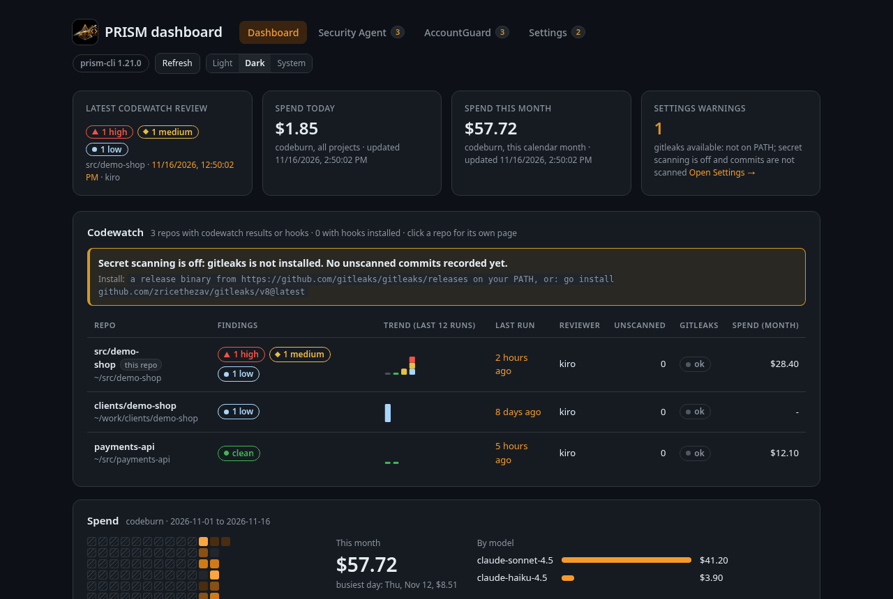

# PRISM editor extension

Shows PRISM inside the editor: VS Code, Kiro IDE and Cursor (any VS Code-family editor, engine 1.90 or later). The PRISM panel is the browser dashboard itself (`prism-cli dashboard`): the same pages, Run buttons and confirm dialogs, drawn from the copy of the UI that ships with your installed prism-cli, so the panel and the CLI are always the same version. The status bar and the Problems panel read `prism-cli dashboard --json` for the open repository, or for the whole machine when no repository is open.

How it compares with the Kiro Crew app and Claude Code, and how it fits with the rest of PRISM: [Using PRISM locally](../USER_GUIDE.md#where-prism-shows-up) in the User Guide. This README covers installing, the features in detail, settings, security, building and releasing.

## Install

The extension is not on a marketplace yet. Download `prism-d1-<version>.vsix` and its `.sha256` from [GitHub Releases](https://github.com/aws-samples/sample-prism-d1-velocity/releases) (the releases tagged `ext-v*`; the CLI itself ships on npm), or build it from source (see Build). To check the download, run `sha256sum -c prism-d1-<version>.vsix.sha256` (macOS: `shasum -a 256 -c ...`) in the folder holding both files. Then:

```bash
code --install-extension prism-d1-<version>.vsix     # VS Code
kiro --install-extension prism-d1-<version>.vsix     # Kiro IDE
cursor --install-extension prism-d1-<version>.vsix   # Cursor
```

Or, in any of them: Extensions view, `...` menu, **Install from VSIX...**.

It needs `prism-cli` 1.21.0 or later (`npm install -g @prism-d1/cli@latest`). With an older prism-cli the panel and the status bar show only **Update prism-cli to 1.21.0 or later** and that command; nothing else runs until you update.

## Remote SSH / dev desktops

With a Remote-SSH window (VS Code, Kiro or Cursor) on a dev desktop, the extension runs on the remote machine, next to the repository and `prism-cli` (`extensionKind: workspace`).

- **Install the `.vsix` into the remote.** Copy it to the remote host, then in the Extensions view use **Install from VSIX...** while connected, or run `code --install-extension prism-d1-<version>.vsix` in the remote terminal. Check that PRISM D1 is listed under **SSH: <host> - Installed**, not only under Local.
- **No ports are needed.** The extension opens no listener and forwards nothing; it only runs `prism-cli` on the remote host. The panel talks to `prism-cli dashboard --serve-stdio` over a pipe, not to the browser dashboard's port.
- **nvm installs are found automatically.** The remote extension host does not read `.bashrc`, so its `PATH` often lacks nvm. When `prism-cli` is not on `PATH`, the extension looks in `$NVM_BIN`, `~/.nvm/versions/node/*/bin` (the `nvm alias default` version first, then the newest), `$VOLTA_HOME/bin` or `~/.volta/bin`, `~/.local/bin`, `~/.npm-global/bin` and `$NPM_CONFIG_PREFIX/bin`. It runs no shell to look. If it still is not found, set `prism.cliPath` in the remote's user settings to the output of `command -v prism-cli`.
- `prism-cli` always runs with its own folder first on `PATH`, so its `#!/usr/bin/env node` line finds the node installed next to it, also when `prism.cliPath` is set.

## Features



*The PRISM panel, rendered with made-up demo data.*

- **PRISM panel** (click the status bar item, or `PRISM: Open panel`): the [local dashboard](../USER_GUIDE.md#local-dashboard)'s Dashboard, repo, Security Agent, AccountGuard and Settings pages. Settings' **Run** buttons run the same allowlisted `prism-cli` commands with the same confirm dialogs as in the browser. Starting a Security Agent code review or threat model (it uploads the repository at `HEAD` to your scan bucket and starts a job in your AWS account) also asks in a VS Code dialog first; **Cancel** there starts nothing. A report link opens the codewatch report in an editor tab. The panel follows the editor's light or dark theme when it opens, and its Light, Dark and System buttons switch it. It runs `prism-cli dashboard --serve-stdio` in the open repository (or your home folder) while it is open, and stops it when you close the panel.
- **Status bar**: `PRISM: 0 high · 2 med | $12.40 today | 1 warning`. The counts come from the latest codewatch pre-push review of the checked-out branch; spend and warnings are for this machine. The tooltip shows the review time, reviewer, monthly spend and sync mode. Click it to open the PRISM panel. When `prism-cli` is missing the item shows an install hint with the folders it searched; when it is older than 1.21.0 it reads `PRISM: update prism-cli`; when codewatch is not set up in the repo it reads `codewatch off · Enable`.
- **Works without a repo (machine mode)**: with no folder open, or no open folder inside a git repository, the extension runs `prism-cli dashboard --json` from your home folder without `--root`, so the CLI scans the repositories under it. The status bar reads `PRISM: $34.08 today | 1 warning`; its tooltip shows this month's spend, the latest review in any repo (repo, time, counts), how many repos have codewatch, and a reminder to open a repository folder to see its findings. The Problems panel is empty. The PRISM panel is the same dashboard as with a repo open.
- **Problems panel**: findings of that review as markers (high = Error, medium = Warning, low = Information, source `PRISM codewatch`, category as the code). Paths are resolved against the repo root; findings for files that are not in this checkout, or that point outside the repo, are skipped. A review of another branch gets no markers, because its line numbers may not match.
- **Quick fixes on a PRISM marker**: **Copy finding as a fix prompt** copies a short prompt (file, line, severity, the finding quoted) to paste into Claude Code or Kiro chat. **Open review report** runs `prism-cli codewatch report --format html` and shows the report.
- **Commands** (`PRISM:` in the Command Palette): Open panel, Refresh (runs with `--fresh`), Open browser dashboard (runs `prism-cli dashboard` in a terminal, so you see its token), Enable codewatch in this repo (asks first, then runs `prism-cli enable codewatch` in a terminal).
- **Refresh**: on startup, when files under `.prism/results/` change (repo mode only; the home folder is not watched), when the window regains focus and the data is older than 60 s, and every 5 minutes. At most one run at a time, with a 2 s debounce.

## Settings

| Setting | Default | |
|---|---|---|
| `prism.cliPath` | empty (found on `PATH`) | Absolute path to `prism-cli`. Machine-scoped: only your user settings count, so a repo's `.vscode/settings.json` cannot point it at another program. Set it when `prism-cli` is not on the editor's `PATH` and not in the folders listed under Remote SSH; use the output of `command -v prism-cli`. |

## Security

- **No network listener and no network calls of its own.** The extension opens no ports, makes no AWS calls itself and sends no telemetry. AWS calls happen only inside `prism-cli`, when you run one of the panel's actions (read-only ones such as `aws check`, and the two confirmed Security Agent starts), exactly as from the browser dashboard.
- **Untrusted folders**: the extension does not run in a folder that is not trusted (`untrustedWorkspaces: false`). An empty window (no folder) is trusted by default (`security.workspace.trust.emptyWindow`), so machine mode runs there; set that setting to `false` and the extension stays off in empty windows too.
- **Running prism-cli**: always `execFile` with an argument array and `shell: false`, run in the repo root (machine mode: the home folder), with a timeout and an output cap. File paths and finding text are never placed in a shell string. Terminal commands start `prism-cli` as the terminal's own process with fixed arguments.
- **Finding text is untrusted model output.** It is shown as plain text, with control and bidi characters removed. It is never rendered as markdown or links and never run. In the fix prompt every line of it is quoted and labelled as reviewer output.
- **Panel webview**: the panel's script and style are prism-cli's own `dist/ui` files, loaded by webview URI from the installed package (the only `localResourceRoots`), never from the network. The CSP is `default-src 'none'`, scripts need a per-panel nonce, and `connect-src 'none'`, so the page cannot fetch anything; recorded text (finding messages, repo names) is placed with `textContent`. The page holds no token.
- **What the panel can ask for**: the webview can only post `{op, path, query | body}`. The extension drops any message whose path is not one of the routes the CLI listed when it started (`get` and `act` separately), whose query values are not strings, or that is larger than 20 KB, and relays the rest to `prism-cli dashboard --serve-stdio`. The CLI checks each one again with the same code as the browser dashboard: exact route names, the action allowlist, `confirm: true` for actions that need it, and the Security Agent check before an AWS upload. The webview never names a path or a command: a repo is an id from the CLI's own scan list.
- **AWS-writing actions ask twice.** The panel's dialog names the command, account, region and bucket and needs its checkbox; then the extension shows a native VS Code dialog before it relays the request. Which actions need it comes from the CLI's own action catalog (`writesAws`), not from anything the webview sends, and an action the catalog does not know also asks. Every other command that writes to AWS (`enable security`, `security pentest`) stays copy-only, as in the browser.
- The review report is shown with scripts off and a CSP that allows only its inline styles.

## Build

```bash
cd editor-extension
npm ci
npm run build     # tsc -> out/
npm test          # unit tests (node:test), vscode API not needed
npm run package   # vsce package -> prism-d1-<version>.vsix (no publish)
```

The tests cover the logic modules (status text, findings to markers, the fix prompt, argv building, finding `prism-cli` in nvm and other per-user folders, the spawn `PATH`, refresh debounce, machine mode's argv and tooltip, the version check, the stdio hello, which webview messages are relayed, the native confirm and the stdio client against a stand-in CLI). `src/extension.ts`, the VS Code wiring, is not run headless.

`npm run test:e2e` runs the panel in a webview harness: the extension's own `ui-host.js` with Chromium standing in for the VS Code webview (VS Code itself needs a display), against a real `prism-cli dashboard --serve-stdio` on demo data, with the fake `aws` CLI from `cli/test/e2e` first on `PATH`. It needs `npm run build` in `cli/` (for the demo data) and a Chromium (`CHROME=`, or the Playwright headless shell). `PRISM_CLI=/path/to/prism-cli` tests another prism-cli, for example one installed from npm; `PRISM_CLI_OLD=` also checks the update panel against an older one.

Known limits in 0.2: one repository per window (the first workspace folder inside a git repo). On Windows, `PATH` lookup finds only `prism-cli.exe`, because npm's `.cmd` shims need a shell; set `prism.cliPath` there.

## Releasing

For maintainers. `.github/workflows/editor-extension-release.yml` runs on tags `ext-v*`: it checks the tag against `package.json`, runs the tests, packages the `.vsix` and creates a GitHub release with the `.vsix` and its `.sha256`. It passes `--latest=false`, so it does not take the Latest label from another release. While the editor extension's releases are the repo's only releases, GitHub still shows the newest as Latest.

1. Bump `version` in `editor-extension/package.json` in a PR and merge it.
2. Tag the merge commit and push the tag:

   ```bash
   git fetch origin
   git tag ext-v<version> <merge-sha>
   git push origin ext-v<version>
   git ls-remote --tags origin ext-v<version>   # check the tag reached GitHub
   ```

The workflow fails if the tag does not match `package.json` or the release already exists. To try the build without releasing, run the workflow by hand (Actions, **Run workflow**): it uploads the `.vsix` as a workflow artifact only.
