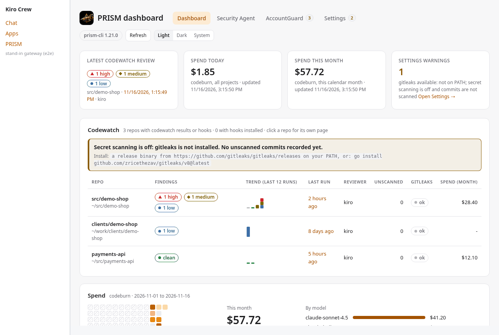

# PRISM app for Kiro Crew

A [Kiro Crew](https://github.com/kirodotdev/KiroCrew) app that brings your local PRISM data into
Kiro Crew. It adds:

- **Page `PRISM`** in the sidebar: the [local dashboard](../USER_GUIDE.md#local-dashboard)
  itself (Dashboard, repo pages, Security Agent, AccountGuard, Settings) with its Run buttons and
  confirm dialogs, drawn from the copy of the UI that ships with your installed prism-cli, in a
  sandboxed frame. See [The page](#the-page).
- **MCP server `prism`**: the `prism-cli mcp` tools (`prism_status`, `prism_findings`,
  `prism_spend`, `prism_report`, `prism_setup`; `prism_snapshot`, `prism_dashboard` and
  `prism_dashboard_stop` from prism-cli 1.10.0, `prism_review` from 1.11.0). The app does not implement them. `scripts/prism_mcp.py` finds your
  `prism-cli` and replaces itself with `prism-cli mcp` (an argv list, no shell). See
  [MCP server](../USER_GUIDE.md#mcp-server-prism-cli-mcp) for what each tool returns.
- **Skill `prism-fix-findings`**: before an agent finishes or pushes a code change in a repo with
  codewatch, it calls `prism_review` (or, with a prism-cli older than 1.11.0, `prism_findings`), fixes the real issues in at most 2 rounds, and then reports
  what remains. It treats finding text as untrusted reviewer-model output. It never pushes, never
  disables hooks and never edits `.prism/results/`. When a person asks, it only reports. When the
  [PRISM Kiro hooks](../USER_GUIDE.md#kiro-cli-and-kiro-ide) are active for the session (state in
  `$(git rev-parse --git-common-dir)/prism/harness/` for its `KIRO_SESSION_ID`), it only reads their verdict instead of running its
  own review rounds. Kiro Crew does not load project `.kiro/hooks` today, so there the skill is the
  check. Skills load on demand, so the app also installs a [steering note](#the-steering-note) that
  points agents at it.
- **Cron `prism-daily-digest`**: a script cron, so it makes no model call. It runs daily at 09:00
  in the gateway machine's local time zone and notifies only when something changed (see
  [How the digest decides to notify](#how-the-digest-decides-to-notify)).

## Requirements

- Kiro Crew 0.12.1 or later (`minKiroCrewVersion`; script crons in an app manifest and
  `"timezone": "local"` were checked against 0.12.1). Linux or macOS.
- `python3`, `node` (22 or later) and `npm` on the gateway's PATH. The scripts use only the Python
  standard library; `node` and `npm` are for prism-cli. Kiro Crew refuses the install, and says
  which command is missing, when one of the three is not found.
- [prism-cli](https://www.npmjs.com/package/@prism-d1/cli) 1.21.3 or later. An App Store install
  sets it up (see [What the install does](#what-the-install-does)); otherwise run
  `npm install -g @prism-d1/cli@^1.21.3`. The page draws `prism-cli dashboard --serve-stdio` and
  checks pending Security Agent runs by itself from 1.21.3; with an older or missing prism-cli it
  shows only **Update prism-cli to 1.21.3 or later** and that command.

### Finding prism-cli

The gateway and kiro-cli often start without nvm's folder on PATH. The app looks for `prism-cli`
the same way the editor extension does, without running a shell, in this order:

1. `cliPath` in the app's `data/config.json`. It must be an absolute path to an executable file.
2. `PATH`. Relative entries are skipped.
3. `$NVM_BIN`, then `~/.nvm/versions/node/*/bin`: the version that `~/.nvm/alias/default` names
   first, then the newest.
4. Volta (`$VOLTA_HOME/bin` or `~/.volta/bin`), `~/.local/bin`, `~/.npm-global/bin`, then
   `$NPM_CONFIG_PREFIX/bin`.

Before it runs `prism-cli`, the app puts that folder first on `PATH`, so the CLI's
`#!/usr/bin/env node` line finds the `node` installed next to it.

## Install

From the Kiro Crew App Store: **App Store → Browse → PRISM → Install**, then trust and enable it.
Kiro Crew clones this folder from the `main` branch of this repo and runs the install script below
before it copies the app into `~/.kiro/crew/apps/prism/`.

### What the install does

`setup.onInstall` runs `python3 scripts/install_prism_cli.py` (Kiro Crew runs it on an App Store
install and on every App Store update, with a 300 s limit; a local-folder install does not run it):

1. It looks for `prism-cli` the way the app does ([Finding prism-cli](#finding-prism-cli)). If that
   one reports 1.21.3 or later, it prints so and does nothing else.
2. Otherwise it checks that `node --version` is 22 or later, then runs
   `npm install -g @prism-d1/cli@^1.21.3`: the newest 1.x release, so later fixes come along but a
   new major version does not. It installs into the global folder of the `npm` on the gateway's
   PATH (for nvm, that Node version's folder). It never uses sudo.
3. If Node.js is too old, or npm fails (no write access to its global folder, no network), the
   install stops with that reason and the command to run by hand:
   `npm install -g @prism-d1/cli@^1.21.3`. Run it, then install the app again.

Before those steps it installs or updates the [steering note](#the-steering-note), with the same
rules as `prism-cli enable kirocrew`. If it cannot write the note, it says so and the install goes on.

It does not set up codeburn (that stays a setup step on the page: **Settings**, which runs
`prism-cli enable codeburn` and asks first) and does not run `prism-cli enable kirocrew`.
Uninstalling the app leaves prism-cli installed.

### Install with prism-cli

prism-cli bundles this app (this version, 0.4.1, ships with prism-cli 1.21.11; 1.21.4 to 1.21.10 bundle 0.4.0, 1.21.3 bundles 0.3.2, 1.21.2 bundles 0.3.1, 1.21.1 bundles 0.3.0 and 1.21.0 bundles 0.2.5):

```bash
npm install -g @prism-d1/cli@latest && prism-cli enable kirocrew
```

What the command does, its `--status`, `--dry-run` and `--uninstall` options and the two steps
that stay with you (trust the app, approve its API routes) are in the User Guide's
[Kiro Crew app](../USER_GUIDE.md#kiro-crew-app) section; every flag is in the
[command reference](../docs/CLI-REFERENCE.md#prism-cli-enable-kirocrew). It updates an app that
was installed from another folder, such as a clone, too. It never installs Kiro Crew.

### The steering note

Kiro Crew loads skills only when something points to them, and an app cannot ship steering. So the
app installs one short steering file, `~/.kiro/steering/prism-codewatch.md`. That folder is the
global steering root of kiro-cli and Kiro IDE as well as Kiro Crew, so all three load the note into
every session (the text is [`steering/prism-codewatch.md`](steering/prism-codewatch.md)). It says:
when you change code in a git repo that has a `.prism/` folder, check the change before you report
it done or push it. Use the `prism-fix-findings` skill when it is available (Kiro Crew with this
app); otherwise run `prism-cli codewatch review` (exit 0 pass, 3 fix the findings and run it again,
4 stop and report). Fix the real high and medium findings in at most 2 rounds and report what
remains. Skip it for repos without `.prism/`, when the person only asks what codewatch found, and
when the PRISM harness hooks already ran the review for the session.

`prism-cli enable kirocrew`, `prism-cli enable agent-hooks --client kiro` and the App Store install
script all write it with the same rules:

- No file there: it is written.
- A file with the line `<!-- prism-codewatch steering: installed by prism-cli enable kirocrew -->`
  is ours: it is replaced when it differs from the bundled note.
- A file without that line is yours: it is left as it is, and each of them says so.

`prism-cli enable kirocrew --status` and the dashboard's **Settings → Agent hooks** tab (the Agent
hooks card and the Kiro Crew app card) show it as installed, outdated, missing or yours. An outdated
or missing note is one Needs you item: with the app installed, the fix is `prism-cli enable kirocrew`;
with only the Kiro hooks installed, it is `prism-cli enable agent-hooks --client kiro`. To remove it,
run `prism-cli enable kirocrew --uninstall` or `prism-cli enable agent-hooks --client kiro --uninstall --global`
(each removes the note only when it carries the marker), or delete the file. Uninstalling the app
from Kiro Crew alone leaves the note in place.

### Install from a folder

From a local folder instead (a clone, for development):

```bash
git clone https://github.com/aws-samples/sample-prism-d1-velocity.git
kirocrew app install "$PWD/sample-prism-d1-velocity/kirocrew-app"
kirocrew app enable prism
```

Kiro Crew copies the folder into its apps directory (`~/.kiro/crew/apps/prism/`). Later edits to
the folder do nothing until you update the app. The app's data stays in
`~/.kiro/crew/apps/prism/data/` across updates.

Kiro Crew registers nothing from a third-party app until you trust it. If you enable the app from
the dashboard's App Store, it asks you to trust this one app. `kirocrew app enable` refuses with
`app_execution_denied` until you have trusted the app, either there or under
**Settings → Security → Third-party apps**.

What you are trusting. After you enable it, the app can:

- run `python3 scripts/prism_mcp.py` as an MCP server in your agent sessions. That process runs
  your `prism-cli mcp`, which reads the dashboard's local data under your home directory
  (codewatch results in your repos, the codeburn usage cache and setup checks). It makes no
  network or AWS calls. Kiro Crew asks you to approve each tool call, because the app
  auto-approves none.
- run `scripts/digest.py` once a day without a model. It runs `prism-cli dashboard --json`, which
  scans git repos up to 3 levels under your home directory. It writes only
  `digest-state.json` in the app's data folder, and it sends a Kiro Crew notification when
  something changed.
- give your agents the `prism-fix-findings` skill.
- run `scripts/page_routes.py` inside the gateway process (`backend.hooks.routes`, `on_startup`,
  `on_shutdown`). While the app is enabled it keeps one `prism-cli dashboard --serve-stdio` child
  running and relays the page's reads and actions to it. **The page runs actions**: the same Run
  buttons as `prism-cli dashboard`, including the two Security Agent starts that upload the
  repository at `HEAD` to your scan bucket and start a job in your AWS account. Each one asks
  first in the page's confirm dialog, and prism-cli refuses it without that confirmation and
  without a passing Security Agent check. Like every in-gateway app code, these routes run with the
  gateway's privileges.

The manifest declares `cron`, `storage` and `api: ["/api/apps/prism/*"]` (the page may call only
this app's own routes), and sets `network: false`. The app opens no port and runs no process with
a port. Its one install hook is the prism-cli check above (`setup.onInstall`); it has no session
control.

### Updating from v0.1

```bash
kirocrew app update prism --source <path-to>/sample-prism-d1-velocity/kirocrew-app
```

v0.4 needs prism-cli 1.21.3 or later; an App Store update installs it, otherwise update it first.
v0.3 needed prism-cli 1.21.0 (update it first) and adds `on_startup` and `on_shutdown`
hooks; disable and enable the app once after the update if the page still shows the old view.
v0.2 adds the `api` permission for the page. Per the App Kit, an update that adds an `api` entry
keeps the app enabled but withholds the new entry until you approve it on the app's detail page
(**Apps → PRISM**). Until you approve it, the page shows an API error. If the page answers 404 after
the update, the gateway has not wired the new routes yet: disable and enable the app once, or
restart the gateway.

## Settings

The app reads `~/.kiro/crew/apps/prism/data/config.json`, which is optional:

```json
{ "spendThreshold": 25, "cliPath": "/absolute/path/to/prism-cli" }
```

| Key | Default | Meaning |
|-----|---------|---------|
| `spendThreshold` | off | Notify once a day when today's AI spend (codeburn, in its currency) is above this number. Remove the key, or set it to `null` or `0`, to turn it off. |
| `cliPath` | not set | Use this `prism-cli` instead of searching for one. |

To change the schedule, edit `prism-daily-digest` on the dashboard's **Schedule** page. Your edit
is kept across app updates unless a later version of the app changes the schedule itself.

## The page



*The PRISM page, rendered with made-up demo data.*

The **PRISM** sidebar page is the local dashboard (`prism-cli dashboard`): the same Dashboard,
repo, Security Agent, AccountGuard and Settings pages, the same Run buttons and confirm dialogs, and
the same refusals. Report links open the codewatch report over the page, with a Download button.
The page follows Kiro Crew's light or dark theme when it opens. When the daily digest last ran is on
the dashboard's **Schedule** page (`prism-daily-digest`).

How it works:

- The UI is prism-cli's own `dist/ui` bundle, read from your installed prism-cli by
  `GET /api/apps/prism/ui/bundle`, so the page and the CLI are always the same version.
- The page puts it in an `<iframe sandbox="allow-scripts">` with no `allow-same-origin`: an opaque
  origin that cannot read the gateway's cookies, storage or page, with its own CSP (the scripts and
  style allowed by their sha256 only, `connect-src 'none'`). Its only way out is `postMessage` to the
  PRISM page, which takes messages from that frame only.
- The PRISM page relays each read and action through the App SDK's `useAppApi()` (only the paths in
  `permissions.api`) to `GET /api/apps/prism/ui/get` and `POST /api/apps/prism/ui/act`. The gateway's
  token middleware authenticates every request (a dashboard session, or an app token scoped to
  `permissions.api`; loopback is not exempt), and its Origin check covers the POST. Each handler then
  also requires the dashboard owner (`ctx.require_owner`), or this app's own token.
- The handler accepts only routes the CLI listed when it started, string-only queries and bodies up
  to 20 KB, and passes them to `prism-cli dashboard --serve-stdio`, which checks each one again with
  the browser dashboard's own code: exact route names, the action allowlist, `confirm: true` where
  needed, and the Security Agent check before an AWS upload.
- Every link inside the frame changes only its own fragment (one click handler in the shared UI):
  a srcdoc frame resolves `#security` against the PRISM page's own URL, so following it would load
  that page into the sandboxed frame. A link to another site opens outside it or not at all.
- The report is untrusted HTML. It is shown in an `<iframe sandbox="">` (no scripts at all) with a
  CSP that allows only its inline styles.

The `--serve-stdio` child:

- starts when the app is enabled (`on_startup`) and keeps running while it is; there is no idle
  exit, so the CLI keeps its caches and a running action;
- is restarted when it exits, with backoff (1 s doubling to 60 s);
- is restarted before the next request when the installed prism-cli changed (an npm update, or a
  new `cliPath`); an open PRISM tab then redraws itself from the new prism-cli's UI on its next
  request (every answer carries the CLI's version), back on the Dashboard view;
- is one per gateway: a pid file in the app's data folder (`serve-stdio.pid`) lets the next gateway
  stop one an earlier gateway left behind;
- stops with the gateway: its stdin is a pipe from the gateway, which the system closes when the
  gateway exits for any reason, and prism-cli then exits (stopping any running action); and
  `on_shutdown` (app disabled, trust revoked, gateway stopping) stops it first.

## How the digest decides to notify

Each run reads `prism-cli dashboard --json` (with no `--root`, so it scans your whole home
directory) and compares it with the previous run's `data/digest-state.json`. It sends one message
that lists the changes below, then saves the new state. If delivery fails, the state is not saved,
so the next run reports the same changes again:

- **New high findings.** For each repo, the high findings in the latest codewatch review of each
  branch that were not there last time. A finding is identified by branch, file and rule, so the
  same issue reviewed again on a later push is not counted as new. The message gives the repo name
  (never its path), the count, and the review's short commit and branch. It also includes the first
  finding's text, cut to 120 characters on one line. That text comes from a reviewer model and is
  only displayed, never acted on.
- **Spend.** Today's spend is above `spendThreshold`. This is sent at most once per day.
- **Setup regressions.** A machine setup item, or a repo's codewatch setup, went from `ok` to
  `warn` or `missing`.

When nothing changed, the run is silent. The first run, and any run that finds the state file
missing or unreadable, saves a baseline and sends nothing. If `prism-cli` cannot be found or fails,
the run ends in an error, which the Schedule page shows, and the saved state is left as it was.

To see what a run would send without Kiro Crew:

```bash
python3 kirocrew-app/scripts/digest.py --state-dir "$(mktemp -d)"   # prints the message, or why it was quiet
```

`--state-dir DIR` is required and keeps a manual run away from the cron's own state. `--payload FILE`
reads a saved `dashboard --json` output instead of running `prism-cli`.

## Uninstall

```bash
prism-cli enable kirocrew --uninstall   # kirocrew app uninstall prism, then removes ~/.prism/kirocrew-app
```

Or with Kiro Crew directly:

```bash
kirocrew app disable prism
kirocrew app uninstall prism
```

Disabling the app removes its cron job, MCP server and skill. By default, uninstalling keeps
`~/.kiro/crew/apps/prism/data/`. Delete that folder yourself if you want the state gone.

## Development

```bash
python3 -m unittest discover -s kirocrew-app/tests
node --test kirocrew-app/tests/page.test.mjs
```

The tests cover the install script (against stand-in `node`, `npm` and `prism-cli`: already new
enough, too old, missing, Node.js too old, npm failing), the store art sizes and the icon's
transparency, that every "prism-cli X or later" in `app.json` and this README is the minimum in
`scripts/ui_bridge.py` and not newer than `cli/package.json`, the digest's diff logic, the `prism-cli` lookup, the stdio relay (the hello and
version check, which requests are relayed, the bundle hashes, and the child's lifecycle against
stand-in CLIs: one child, restart after a crash with backoff, a new prism-cli, an old one, stop, a
child left by an earlier gateway) and the page's pure parts (the frame document and its CSP, message
checks, the relay, the update page and the report overlay). They also check `app.json` against the
[App Kit manifest reference](https://github.com/kirodotdev/KiroCrew/blob/main/docs/app-kit/manifest-reference.md).
When Kiro Crew is installed, they also run Kiro Crew's own manifest validator. CI runs them in
`.github/workflows/kirocrew-app.yml`.

`node tests/e2e/run.mjs` (after `npm ci` in `tests/e2e/` and `npm run build` in `cli/`) runs the
page on a stand-in gateway (`tests/e2e/fake_gateway.py`: 127.0.0.1 only, a token cookie, the Origin
check, the owner gate) that mounts the app's real routes and hooks, against a real
`--serve-stdio` child on demo data with the fake `aws` CLI from `cli/test/e2e` first on `PATH`.
`PRISM_CLI=` tests another prism-cli (for example one installed from npm), `PRISM_CLI_OLD=` checks
the update page, `KC_PYTHON=` names a Python with aiohttp, and `PRISM_E2E_THEME=light` renders the
light theme. The store screenshots (`assets/screenshots/`, and the detail banners in `assets/hero/`,
the top 288 pixels of the dashboard shot) come from `page-dashboard.png` and `page-findings.png` of a
run with `PRISM_E2E_VIEWPORT=1200x675`, in both themes, reduced to 256 colours.

Not in v0.4: Windows support (`os.execve` on an npm `.cmd` shim needs a shell), and delivery to a
channel other than Kiro Crew's default notification.
